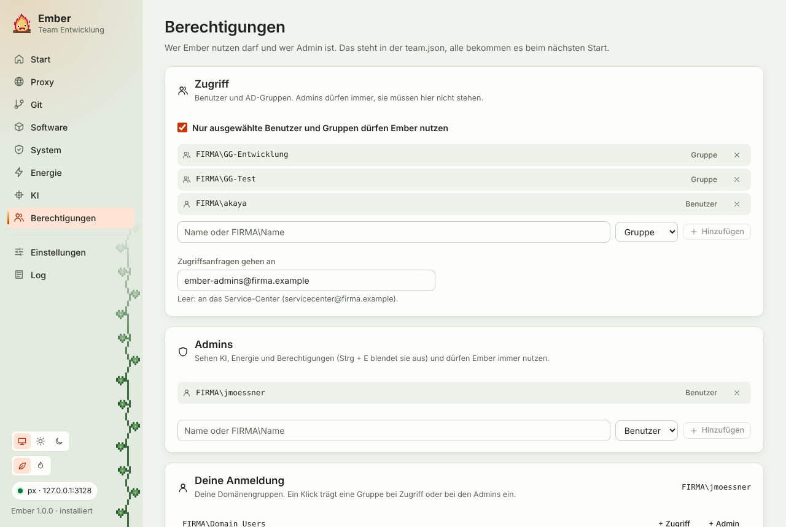

Ember lässt sich auf ausgewählte Benutzer und AD-Gruppen beschränken. Beide Listen stehen in der [Team-Konfiguration](/Ember/handbuch/team-konfiguration/#access), damit sie für alle gelten und nicht auf jedem Rechner einzeln gepflegt werden. Admins bearbeiten sie im Tab **Berechtigungen**. Er steht neben KI und Energie und lässt sich wie diese mit <kbd>Strg</kbd> + <kbd>E</kbd> ein- und ausblenden.

## Die Listen

**Zugriff**: Wer Ember nutzen darf. Solange „Nur ausgewählte Benutzer und Gruppen dürfen Ember nutzen“ aus ist, darf jeder, der die `team.json` lesen kann. Admins dürfen immer, sie müssen hier nicht stehen.

**Admins**: Wer die erweiterten Module sieht und die Listen ändern darf.

Am einfachsten sind AD-Gruppen, die es ohnehin gibt, etwa die Gruppe eures Teams. Dann wächst die Liste mit, wenn die IT jemanden in die Gruppe aufnimmt, und in Ember ist nichts zu tun.

Einen Eintrag fügst du per Name hinzu, mit oder ohne Domäne (`jmoessner` oder `FIRMA\jmoessner`). Ember schlägt den Namen im Verzeichnis nach, schreibt ihn in der richtigen Form und erkennt selbst, ob es ein Benutzer oder eine Gruppe ist. Gibt es den Namen nicht, kommt er nicht in die Liste. Ohne Verbindung zum Verzeichnis (kein VPN) trägt Ember ihn ungeprüft mit der gewählten Art ein und sagt das dazu.

Unter „Deine Anmeldung“ stehen deine eigenen Domänengruppen. Ein Klick auf „+ Zugriff“ oder „+ Admin“ übernimmt eine davon.

„Zugriffsanfragen gehen an“ legt fest, wohin die Mail vom Sperrbildschirm geht. Leer heißt: ans Service-Center.

## Speichern

„In team.json speichern“ schreibt die beiden Abschnitte `access` und `admins` zurück in die Datei auf dem Netzlaufwerk. Alles andere bleibt Zeichen für Zeichen stehen, auch Reihenfolge, Einrückung und Zeilenenden. Vorher legt Ember eine Kopie der alten Fassung unter `C:\Ember\Config\team-backups` ab (die letzten 20).

Ember speichert nicht, wenn

- jemand die `team.json` geändert hat, seit du die Seite geöffnet hast. Dann neu laden, prüfen, noch einmal speichern.
- du dich damit selbst als Admin austragen würdest. Du musst direkt oder über eine deiner Gruppen Admin bleiben.
- die Datei gerade nicht erreichbar ist (VPN, Netzlaufwerk) oder du sie nur lesen darfst. Die Seite sagt das oben, die Knöpfe sind dann aus.

Schreibrechte auf die `team.json` vergibt die IT auf dem Netzlaufwerk. Für alle anderen reichen Leserechte. Die anderen bekommen die neuen Listen beim nächsten Start von Ember, oder sofort mit „Neu laden“ in den Einstellungen.

## Was Nutzer ohne Zugriff sehen

Wer nicht auf der Liste steht, sieht statt der Oberfläche einen Hinweis mit seinem Anmeldenamen und zwei Knöpfen:

- **Zugriff anfragen** öffnet eine vorbereitete Mail (Vorlage `accessRequest`) an die eingetragene Adresse.
- **Erneut prüfen** liest die `team.json` neu. Steht der Name inzwischen drin, startet die Oberfläche.

Mehr zeigt die Oberfläche nicht, und die Exe lehnt alle anderen Aufrufe ab. Im Hintergrund sucht Ember weiter nach Updates.

:::note[Keine Sicherheitsgrenze]
Die Liste hält Ember aus den falschen Händen, schützt aber nichts. Ember läuft mit den Rechten des Benutzers und kann nichts, was der Benutzer nicht auch selbst könnte. Der Code ist öffentlich, und wer will, baut sich eine Exe ohne die Prüfung. Was wirklich geschützt werden muss, schützen die Rechte auf Netzlaufwerk, Softwarecenter und Proxy.
:::
