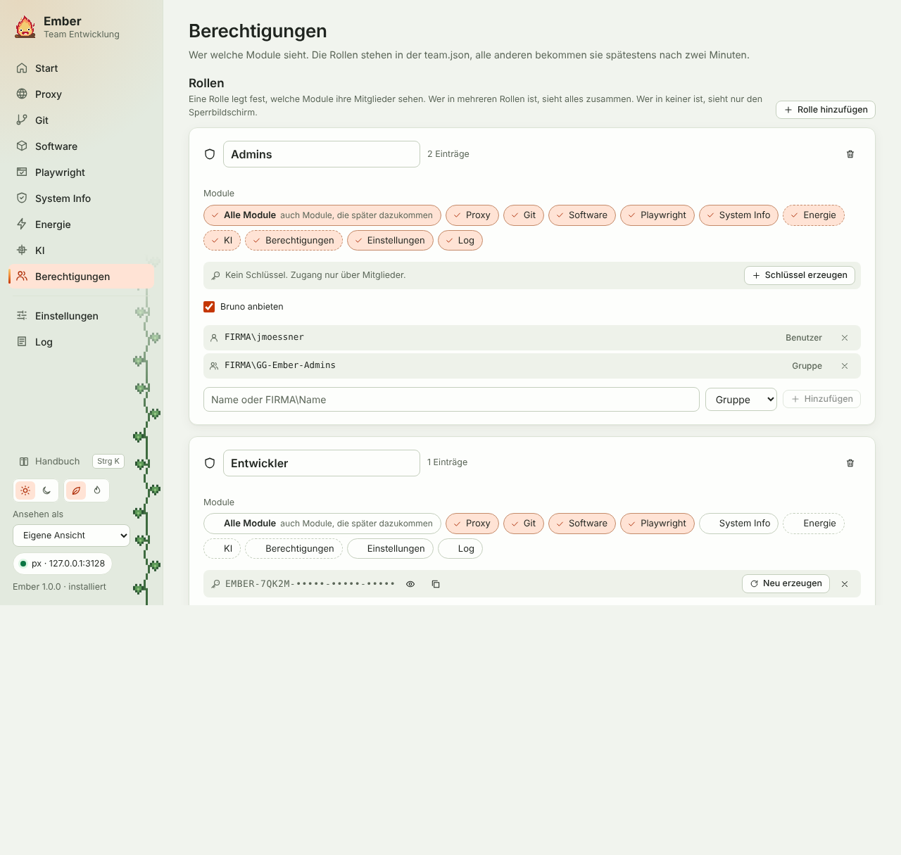

Jeder Tab in Ember ist ein Modul: Proxy, Git, Software, Playwright, System Info, Energie, KI, Berechtigungen, Einstellungen und Log. Wer welches Modul sieht, steht in der **Teamdatei** (`team.ember`) auf dem Netzlaufwerk. Wer dort in keiner Rolle steht, sieht nur einen Sperrbildschirm. Es gibt keine Schlüssel und kein „Zugriff anfragen“: Wer nicht drinsteht, kommt nicht rein.

Den Tab **Berechtigungen** sieht nur, wer eine Rolle mit dem Modul Berechtigungen hat. Oben steht, wie es um die Teamdatei steht: signiert oder nicht, welche Version, wer sie zuletzt signiert hat. Darunter liegen vier Reiter.

## Rollen

Links stehen die Rollen, rechts die gerade gewählte. Eine Rolle hat einen Namen, Module und Mitglieder. Wer in mehreren Rollen ist, sieht die Module aller seiner Rollen zusammen.

- **Module** klickst du als Kacheln an, gruppiert nach Alltag, Erweitert und Sonstiges. „Alle Module“ gibt auch die, die in späteren Versionen dazukommen.
- **Installationen** erscheint bei Rollen mit dem Modul Software: Node.js, Git, VS Code, Python, Visual Studio, .NET SDK, PowerShell 7 und Bruno, also alles, was Ember direkt beim Hersteller holt. Was nicht markiert ist, bietet Ember der Rolle nicht an und installiert es auch nicht. Pakete aus dem Softwarecenter sind davon nicht betroffen, die stehen immer da. Wer in mehreren Rollen ist, bekommt ein Werkzeug, sobald eine davon es anbietet.
- **Mitglieder** suchst du direkt im Active Directory: zwei Buchstaben eintippen, und Ember schlägt passende Benutzer und Gruppen vor, mit Anzeigename, Konto und E-Mail bzw. Beschreibung. Mit den Pfeiltasten und Enter oder per Klick übernehmen. Die Suche läuft mit deinem Windows-Login über LDAP, wie jede Abfrage im Verzeichnis; extra Rechte braucht es nicht, nur Domäne oder VPN. Ohne Verbindung tippst du den Namen aus und drückst Enter; Ember prüft ihn dann, sobald es kann. Unter „Deine Gruppen“ stehen deine eigenen Domänengruppen zum schnellen Hinzufügen.

Am einfachsten sind AD-Gruppen, die es ohnehin gibt. Nimmt die IT jemanden in die Gruppe auf, hat er die Rolle, ohne dass sich an der Teamdatei etwas ändert. Leute ohne passende Gruppe, etwa Externe, trägst du als Benutzer ein.

Typisch sind drei Rollen:

| Rolle | Module | Mitglieder |
|---|---|---|
| Admins | alle | die Leute, die Ember betreuen |
| Entwickler | Proxy, Playwright, Git, Software (Installationen ohne Bruno) | die AD-Gruppe der Entwicklung |
| Test | Proxy, Playwright | die Testgruppe |

## Sperrliste

Wer auf der Sperrliste steht, als Benutzer oder über eine Gruppe, kommt nicht in Ember, auch wenn eine Rolle ihn nennt. Der Sperrbildschirm sagt ihm das. Das ist der schnelle Weg, jemanden auszuschließen, ohne an Gruppen zu drehen.

## Team

Die Einstellungen, die jede Teamdatei braucht:

- **Service-Center**: Adresse, Name, Text vor jedem Betreff und der erste Satz bei „Problem melden“.
- **Vorgesetzte bzw. Vorgesetzter**: bekommt die Bitte um Adminrechte.
- **Playwright**: der Ordner der [Projektvorlage](/Ember/handbuch/playwright/#die-vorlage) und ein Spiegel für die Browser-Downloads.
- **Updates**: ein Spiegelordner, falls GitHub gesperrt ist.
- **Mailtexte**: eigene Betreffe und Texte. Leer heißt: Embers eigener Text.

## Teamdatei

Hier stehen Pfad, Version, wer wann signiert hat und mit welchem Schlüssel. Unter **Weitere Einstellungen** steht alles Optionale als JSON, etwa interne Domains, eine Softwareliste oder Energieprofile (siehe [Team-Konfiguration](/Ember/handbuch/team-konfiguration/)). Es wird mit signiert.

## Signieren und speichern

Geändert wird die Teamdatei nur über „Signieren und speichern“ unten auf der Seite. Ember fragt nach der Schlüsseldatei und ihrem Passwort, zählt die Version hoch, schreibt den Pfad der Datei hinein und unterschreibt alles. Den Pfad zur Schlüsseldatei merkt sich Ember, das Passwort nicht. Die alte Fassung landet vorher unter `C:\Ember\Config\team-backups`.

Ember speichert nicht, wenn

- jemand die Teamdatei geändert hat, seit du die Seite geöffnet hast. Dann neu laden, prüfen, noch einmal speichern.
- du dich damit selbst aussperren würdest: Eine deiner Rollen muss das Modul Berechtigungen behalten, und du darfst nicht auf der Sperrliste stehen.
- zwei Rollen gleich heißen oder eine keinen Namen hat.
- der Schlüssel nicht zu dieser Ember-Version gehört oder das Passwort nicht passt.
- die Datei gerade nicht erreichbar ist (VPN, Netzlaufwerk) oder du sie nur lesen darfst.

Die anderen bekommen die Änderung beim nächsten Start von Ember, spätestens aber nach zwei Minuten.

## Warum signiert

Die Teamdatei ist lesbar, aber nur die Admins können sie ändern. Ember enthält die öffentlichen Schlüssel der Admins und lädt eine Teamdatei nur, wenn

1. ihre Signatur zu einem dieser Schlüssel passt. Eine selbst gebaute oder veränderte Datei fällt durch.
2. sie an dem Ort liegt, für den sie signiert wurde. Eine Kopie auf dem eigenen Rechner fällt durch. Ein Laufwerksbuchstabe wie `Z:\` zählt dabei wie der Netzwerkpfad dahinter.
3. ihre Version nicht älter ist als die, die Ember zuletzt gesehen hat. Eine aufgehobene alte Fassung fällt durch.

Ist das Netzlaufwerk nicht erreichbar, nimmt Ember seine lokale Kopie, höchstens 14 Tage lang. Danach bleibt Ember gesperrt, bis der Share wieder da ist.

:::note[Was die Signatur leistet]
Sie sorgt dafür, dass die normale Ember-Exe nur macht, was ihr freigegeben habt. Wer den öffentlichen Code nimmt und sich eine Exe ohne Prüfung baut, umgeht sie. Das lässt sich bei einem Programm auf dem eigenen Rechner nicht verhindern, ist aber kein Loch: Ember kann nur, was der Benutzer mit seinen Windows-Rechten ohnehin darf. Was wirklich geschützt werden muss, schützen die Rechte auf Netzlaufwerk, Softwarecenter und Proxy.
:::

## Einrichten: Schlüssel und erste Teamdatei

Das passiert einmal, durch die Admins:

1. Ember ohne eingebauten Schlüssel starten (so ist es, solange `config/team-signing.pub` fehlt). Diese Version nimmt auch eine unsignierte `team.json`, etwa die aus dem Beispiel `config/team.example.json` mit euren Namen.
2. Im Tab Berechtigungen, Reiter **Teamdatei**, „Neuen Schlüssel erzeugen“: Ordner wählen, den nur Admins lesen können, Passwort mit mindestens 12 Zeichen. Ember legt `ember-team-signing.pem` an (passwortgeschützt) und zeigt den öffentlichen Schlüssel.
3. „Signieren und speichern“: Ember legt neben der `team.json` die signierte `team.ember` an und nutzt ab dann diese.
4. Den öffentlichen Schlüssel in `config/team-signing.pub` eintragen und eine neue Ember-Version bauen. Ab dieser Version nimmt Ember nur noch signierte Teamdateien.

Mehrere öffentliche Schlüssel dürfen untereinander in der Datei stehen. So lässt sich ein Schlüssel ohne Ausfall wechseln: neuen dazu, neue Version verteilen, mit dem neuen signieren, den alten entfernen.

## Ansehen als

Unten in der Seitenleiste steht für Admins **Ansehen als**. Dort wählst du eine Rolle oder „Ohne Rolle“. Ember zeigt sich dann so wie für diese Leute: dieselben Tabs, dieselbe Startseite, und auch die Exe lässt nur zu, was die Rolle darf. „Zurück zur eigenen Ansicht“ unten in der Mitte bringt dich zurück, auch wenn die gewählte Rolle das Modul Berechtigungen nicht hat. Nach einem Neustart siehst du wieder deine eigene Ansicht.
