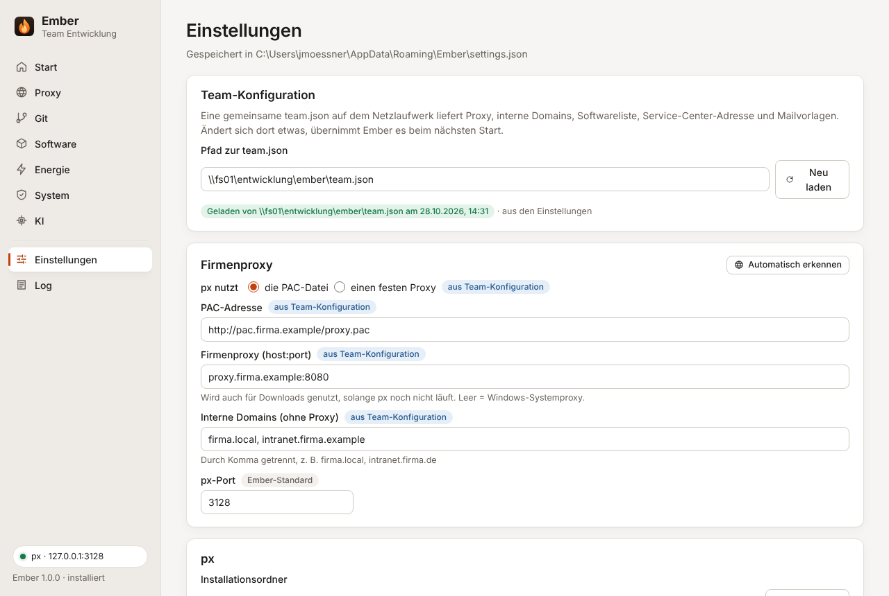

Die Einstellungen liegen in `%APPDATA%\Ember\settings.json`. Änderungen gelten erst nach „Speichern“. Solange etwas offen ist, steht unten eine Leiste mit „Ungespeicherte Änderungen“.

## Wer gewinnt: du, das Team oder Ember

Proxy, PAC-Adresse, interne Domains und px-Port kann auch die Team-Konfiguration vorgeben. Ember nimmt in dieser Reihenfolge:

1. deinen eigenen Wert, falls du einen eingetragen hast,
2. sonst den Wert aus der Team-Konfiguration,
3. sonst Embers Standard.

Neben jedem dieser Felder steht, woher der Wert gerade kommt: „eigener Wert“, „aus Team-Konfiguration“ oder „Ember-Standard“. Bei eigenen Werten stellt „Auf Team-Wert zurücksetzen“ den Team-Wert wieder her.

Der Vorteil: Ändert die IT den Proxy, trägt jemand ihn einmal in `team.json` ein, und alle, die nichts Eigenes eingetragen haben, bekommen ihn beim nächsten Start. Wer einen eigenen Wert hat, behält ihn.

## Die Bereiche

| Bereich | Inhalt |
|---|---|
| Team-Konfiguration | Pfad zur `team.json`, Stand und Quelle, „Neu laden“ |
| Firmenproxy | PAC-Datei oder fester Proxy, PAC-Adresse (leer = aus Windows), Firmenproxy als `host:port`, interne Domains, px-Port, „Automatisch erkennen“ |
| px | Installationsordner, lokales px-Zip statt Download, Autostart |
| Werkzeuge | welche Werkzeuge die px-Installation umstellt |
| Sprache | wie Windows, Deutsch, Deutsch (Schweiz), English |
| Updates | automatisch suchen, „Jetzt prüfen“, Stand und Quelle |
| Erweitert | erweiterte Module (KI-Tab und Entwicklerwerkzeuge der Oberfläche) |
| Ordner | öffnet Logs, Einstellungen, px, px-Konfiguration und Berichte im Explorer |

„Automatisch erkennen“ liest die PAC-Adresse aus Windows, lädt die PAC-Datei und übernimmt den ersten Proxy daraus als Firmenproxy. Gespeichert wird auch das erst nach deiner Bestätigung.
