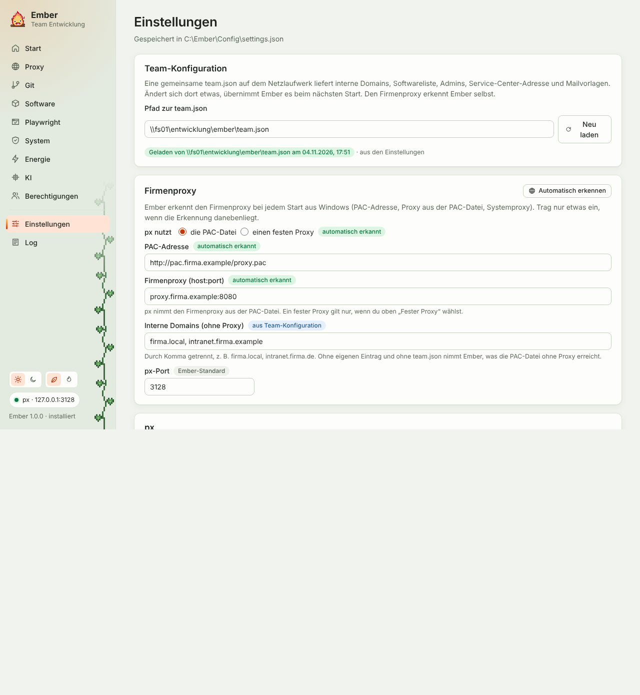

Die Einstellungen liegen in `C:\Ember\Config\settings.json`. Änderungen gelten erst nach „Speichern“. Solange etwas offen ist, steht unten eine Leiste mit „Ungespeicherte Änderungen“.

## Woher die Proxy-Werte kommen

Den Firmenproxy erkennt Ember bei jedem Start selbst: die PAC-Adresse aus Windows, den ersten Proxy aus der PAC-Datei oder den Systemproxy. Für PAC-Datei und Firmenproxy nimmt Ember:

1. deinen eigenen Wert, falls du einen eingetragen hast,
2. sonst das, was Ember beim Start erkannt hat,
3. sonst Embers Standard.

Interne Domains und px-Port kann die Team-Konfiguration vorgeben. Hier gilt: dein eigener Wert, sonst der aus der `team.json`, sonst der Standard.

Neben jedem dieser Felder steht, woher der Wert gerade kommt: „eigener Wert“, „aus Team-Konfiguration“, „automatisch erkannt“ oder „Ember-Standard“. Bei eigenen Werten stellt der Knopf daneben den Team- oder den erkannten Wert wieder her.

Ändert die IT den Proxy, braucht es also nichts weiter: Beim nächsten Start erkennt Ember den neuen. Wer einen eigenen Wert hat, behält ihn.

## Die Bereiche

| Bereich | Inhalt |
|---|---|
| Team-Konfiguration | Pfad zur `team.json`, Stand und Quelle, „Neu laden“ |
| Firmenproxy | PAC-Datei oder fester Proxy, PAC-Adresse (leer = aus Windows), Firmenproxy als `host:port`, interne Domains, px-Port, „Automatisch erkennen“ |
| Darstellung | Design „Efeu“ oder „Glut“, hell oder dunkel, und ob Ember im Hintergrund durchscheint. Farbschema und Design gibt es auch unten in der Seitenleiste. |
| px | Installationsordner, lokales px-Zip statt Download, Autostart |
| Werkzeuge | welche Werkzeuge die px-Installation umstellt |
| Sprache | Deutsch oder English, vorausgewählt ist die Windows-Sprache |
| Updates | automatisch suchen, „Jetzt prüfen“, Stand und Quelle |
| Deine Module | deine Rollen aus der `team.json` oder der Schlüssel, mit dem Ember freigeschaltet ist; Energie, KI und Berechtigungen blendest du mit <kbd>Strg</kbd> + <kbd>E</kbd> aus und ein |
| Ordner | öffnet Logs, Einstellungen, px, px-Konfiguration und Berichte im Explorer |

Die Erkennung läuft bei jedem Start von selbst. „Automatisch erkennen“ macht dasselbe auf Knopfdruck und trägt das Ergebnis als eigenen Wert ein. Gespeichert wird auch das erst nach deiner Bestätigung.

Wählst du die Sprache, die auch Windows hat, folgt Ember weiter der Windows-Einstellung. Auf einem Schweizer Windows schreibt Ember dann „ss“ statt „ß“.

## Darstellung

Ember hat zwei Designs. **Efeu** ist am Tag hell und salbeigrün, nachts waldgrün mit dunkelgrüner Seitenleiste. An der Seitenleiste rankt Efeu hoch, die Akzente sind glutrot. **Glut** ist wärmer: rosiger Grund am Tag, verkohltes Ochsenblut bei Nacht, Moosgrün für „erledigt“. Beide gibt es hell und dunkel. Beim allerersten Start übernimmt Ember, was Windows gerade nutzt, danach bleibt deine Wahl.

Beim Umschalten wächst das neue Aussehen als Kreis aus dem gedrückten Schalter. Wer unter Windows „Animationseffekte“ abgeschaltet hat, bekommt den Wechsel ohne Animation. Die Wahl merkt sich Ember in `settings.json`, auch die Titelleiste des Fensters passt sich an.

### Im Hintergrund

Fenstermanager wie GlazeWM, den WinMarchy einrichtet, lassen Fenster durchscheinen, solange sie nicht im Vordergrund sind. Sie tun das über die Deckkraft des ganzen Fensters. Den Inhalt von Ember zeichnet aber WebView2, und WebView2 übergeht diese Deckkraft. Deshalb blieb Ember bisher deckend. Jetzt liest Ember die Deckkraft selbst aus und zeichnet die Seite genauso durchscheinend:

| Einstellung | Verhalten |
|---|---|
| Wie der Fenstermanager | Standard. Macht GlazeWM inaktive Fenster durchscheinend, macht Ember dasselbe, mit derselben Deckkraft. Ohne Fenstermanager bleibt Ember deckend. |
| Immer leicht durchscheinend | Ist Ember nicht im Vordergrund, scheint der Desktop mit 90 % Deckkraft durch. Nur, wenn in Windows die Transparenzeffekte an sind. |
| Nie durchscheinend | Ember bleibt immer deckend. |

Sobald Ember wieder im Vordergrund ist, ist es sofort deckend.
