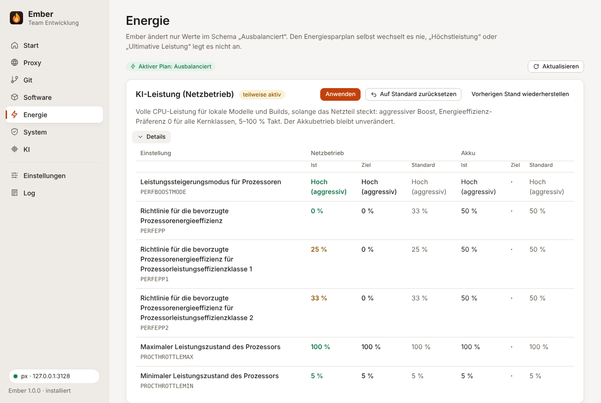

## Warum nur „Ausbalanciert“

In vielen Firmen verbietet eine Gruppenrichtlinie die Energiepläne „Höchstleistung“ und „Ultimative Leistung“. Ember wechselt den Energiesparplan deshalb nie und legt auch keinen neuen an. Es ändert nur Werte innerhalb des erlaubten Schemas, standardmäßig „Ausbalanciert“. Die Team-Konfiguration kann das unter `power.allowedSchemes` festlegen.

Ember liest die Werte mit `powercfg /qh`. Das zeigt auch versteckte Einstellungen wie den Boost-Modus und die Energieeffizienz-Präferenz, ohne sie erst mit `/attributes` sichtbar zu machen. Die Ausgabe von powercfg ist übersetzt („Index der aktuellen Wechselstromeinstellung“ oder „Current AC Power Setting Index“). Ember wertet sie deshalb über GUIDs und Hex-Werte aus, nie über den Text.

## Die Profile

Jede Profilkarte zeigt pro Einstellung drei Werte, getrennt für Netzbetrieb und Akku:

- **Ist**: der aktuelle Wert. Grün, wenn er dem Ziel entspricht, sonst Orange.
- **Ziel**: was das Profil setzen will. Ein Punkt heißt, das Profil lässt diese Seite in Ruhe.
- **Standard**: die Werkseinstellung des Herstellers. Ember liest sie aus `DefaultPowerSchemeValues` in der Registry.

| Profil | Was es tut |
|---|---|
| KI-Leistung (Netzbetrieb) | Boost-Modus „Hoch (aggressiv)“, Energieeffizienz-Präferenz 0, minimaler Prozessorzustand 5 %, maximaler 100 %. Nur am Netzteil, der Akku bleibt unverändert. |
| Kein Standby am Netzteil | Kein Standby, kein Ruhezustand, Bildschirm aus nach 15 Minuten |
| Deckel & Netzschalter | Zuklappen am Netzteil: nichts tun. Netzschalter: herunterfahren. |

Bei KI-Leistung setzt Ember die Werte für alle Effizienzklassen des Prozessors. Auf Hybrid-CPUs mit P- und E-Kernen gibt es dieselbe Einstellung bis zu dreimal (`PERFEPP`, `PERFEPP1`, `PERFEPP2`). Wer nur die erste ändert, lässt die anderen Kerne auf dem alten Wert. Gibt es eine Variante auf dem Rechner nicht, überspringt Ember sie.

„Anwenden“ sichert vorher die aktuellen Werte. „Auf Standard zurücksetzen“ stellt die Werkseinstellung her, „Vorherigen Stand wiederherstellen“ den Stand vor der ersten Änderung.

Werte, die per Gruppenrichtlinie festgelegt sind, fasst Ember nicht an und markiert sie. Braucht eine Änderung Adminrechte, fragt Windows einmal nach. Brichst du ab, bietet Ember die Mail ans Service-Center mit den genauen `powercfg`-Befehlen an.

Die Profile kann die Team-Konfiguration ersetzen oder ergänzen, siehe [Team-Konfiguration](/Ember/handbuch/team-konfiguration/#energieprofile).

## Wake-on-LAN für diesen Rechner

Die Karte unten richtet diesen Rechner so ein, dass er sich aus dem ausgeschalteten Zustand (S5) wecken lässt. Der Zielzustand stammt von einem Dell, auf dem das funktioniert, angeschlossen über ein Dock mit Realtek-USB-Netzwerkkarte, dazu der Intel-I226-Anschluss im Gerät.

Für jeden kabelgebundenen Adapter prüft Ember:

| Einstellung | Ziel | Pflicht? |
|---|---|---|
| Bei Magic Packet aufwecken (`*WakeOnMagicPacket`) | an | ja |
| Wecken aus „Herunterfahren“ (`S5WakeOnLan` bei Realtek, `WakeOnMagicPacketFromS5` bei Intel, `EnablePME` bei älteren Intel-Treibern) | an | ja, falls der Treiber sie kennt |
| Gerät darf den Computer aktivieren (`powercfg /devicequery wake_armed`) | ja | ja |
| Bei Musterübereinstimmung aufwecken, Wake on link change | an | nein, Hinweis |
| WoL-Linkgeschwindigkeit | 10 Mbit/s zuerst | nein, Hinweis |

Dazu kommt der Windows-Schnellstart: Er muss aus sein, sonst fährt Windows nicht richtig herunter und die Netzwerkkarte bekommt das Magic Packet nicht mit. Energiesparfunktionen wie EEE oder Green Ethernet lässt Ember in Ruhe, für WOL braucht es sie nicht.

„Zielzustand herstellen“ setzt alles mit einer Windows-Abfrage nach Adminrechten. Die Netzwerkverbindung ist dabei für ein paar Sekunden weg. „Auf Standard zurücksetzen“ stellt die Treiber-Standardwerte wieder her, schaltet den Schnellstart ein und nimmt die Weck-Erlaubnis nur dort zurück, wo Ember sie selbst erteilt hat.

Die MAC-Adresse jedes Adapters lässt sich kopieren. Die trägst du auf dem anderen Rechner im [KI-Tab](/Ember/handbuch/ki/#rechner-wecken) ein. Bei einem Dock mit MAC-Pass-Through ist das die Adresse, die Windows beim Dock-Adapter anzeigt.

:::caution[Das BIOS kann Ember nicht prüfen]
Bei Dell-Geräten müssen im BIOS „Wake on LAN“ und „Wake on Dell USB-C Dock“ eingeschaltet sein, je nach Gerät auch „MAC Address Pass-Through“. „Deep Sleep Control“ muss aus sein.
:::
