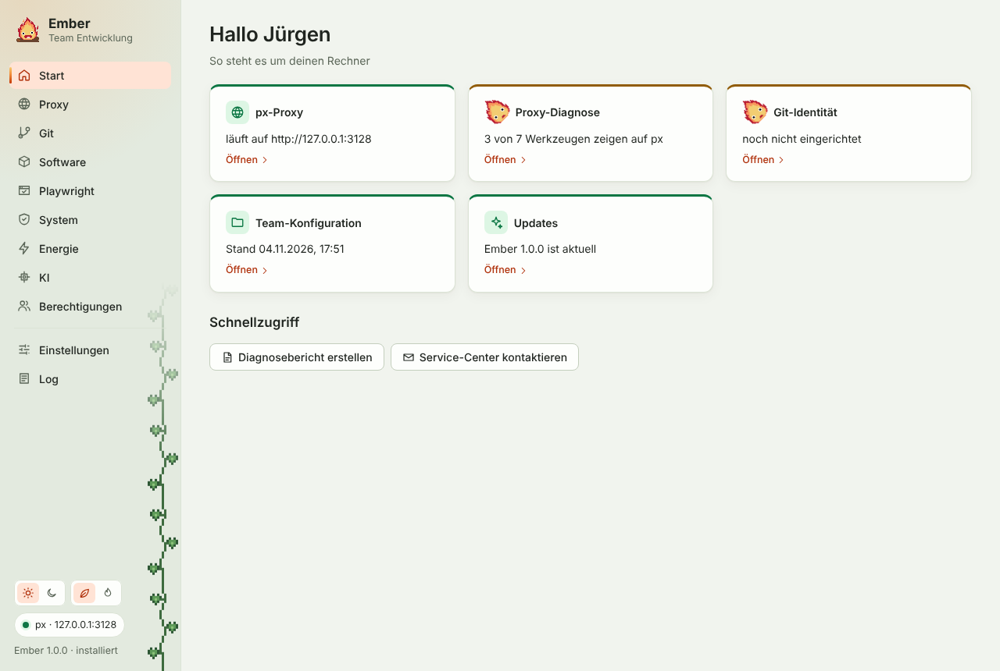

Die Startseite zeigt in Karten, was noch fehlt: px, die Proxy-Diagnose, die git-Identität, die Team-Konfiguration und Updates. Du siehst nur die Karten zu den Modulen, die deine [Rollen](/Ember/handbuch/berechtigungen/) freigeben. Grün heißt erledigt, Orange heißt, da ist noch etwas zu tun. Ein Klick auf eine Karte öffnet die passende Seite.

Wo etwas fehlt oder falsch eingestellt ist, sitzt Calcifer, der kleine Feuerdämon, auf der Karte. Du triffst ihn auch in den anderen Tabs, überall dort, wo noch etwas einzurichten ist: neben Hinweisen, bei Prüfungen unter System und bei leeren Listen.

Auf einem frischen Rechner geht es in dieser Reihenfolge am schnellsten:

1. Die `team.json` verbinden. Startest du Ember vom Netzlaufwerk neben der `team.json`, passiert das von selbst. Sonst fragt Ember beim ersten Start nach dem Pfad oder einem Schlüssel, siehe [Installation](/Ember/handbuch/installation/#der-erste-start). Danach kennt Ember die internen Domains und alles, was das Team vorgibt. Den Firmenproxy erkennt Ember beim Start selbst.
2. Unter Proxy auf „Installieren / Aktualisieren“ klicken. Ember lädt px von GitHub, prüft die Prüfsumme, schreibt die `px.ini`, richtet den Autostart ein und stellt Umgebungsvariablen, git, npm, NuGet und pip auf px um. Jeder Schritt zeigt seinen Status. Nach einem Fehler setzt „Ab Fehler wiederholen“ genau dort wieder an.
3. Die git-Identität setzen. Ember schlägt Name und E-Mail aus dem Active Directory vor, du prüfst und speicherst.
4. Unter Software „Fehlende installieren“ für die Entwicklerwerkzeuge (Node.js mit npm, Git, VS Code, Python, Visual Studio, .NET SDK, PowerShell 7), danach die Programme aus der Team-Liste über das Softwarecenter.
5. Wer lokal Modelle laufen lässt und das Modul Energie hat, wendet dort das Profil „KI-Leistung (Netzbetrieb)“ an.

Unten auf der Startseite gibt es zwei Abkürzungen: „Diagnosebericht erstellen“ speichert einen Bericht und kopiert ihn in die Zwischenablage, „Service-Center kontaktieren“ öffnet die vorbereitete Mail.

## Die Seitenleiste

Die Seitenleiste zeigt nur die Tabs, die deine Rollen freigeben. Unten links siehst du jederzeit, ob px läuft und auf welchem Port, sofern du den Proxy-Tab hast. Darunter stehen die Ember-Version und der Modus (installiert oder portabel).

Energie, KI und Berechtigungen sind erweiterte Module. <kbd>Strg</kbd> + <kbd>E</kbd> blendet sie aus und wieder ein, wenn eine deiner Rollen sie hat.

## Sprache

Ember richtet sich nach der Anzeigesprache von Windows: Deutsch für alle deutschsprachigen Einstellungen, sonst Englisch. Unter **Einstellungen → Sprache** wählst du Deutsch oder English. Auf einem Schweizer Windows schreibt Ember „ss“ statt „ß“.
