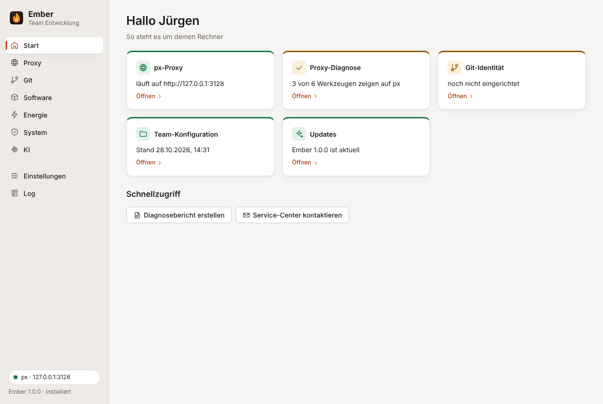

Die Startseite zeigt in fünf Karten, was noch fehlt: px, die Proxy-Diagnose, die git-Identität, die Team-Konfiguration und Updates. Grün heißt erledigt, Orange heißt, da ist noch etwas zu tun. Ein Klick auf eine Karte öffnet die passende Seite.

Auf einem frischen Rechner geht es in dieser Reihenfolge am schnellsten:

1. Unter Einstellungen den Pfad zur `team.json` eintragen. Danach kennt Ember den Firmenproxy und die internen Domains.
2. Unter Proxy auf „Installieren / Aktualisieren“ klicken. Ember lädt px von GitHub, prüft die Prüfsumme, schreibt die `px.ini`, richtet den Autostart ein und stellt Umgebungsvariablen, git, npm, NuGet und pip auf px um. Jeder Schritt zeigt seinen Status. Nach einem Fehler setzt „Ab Fehler wiederholen“ genau dort wieder an.
3. Die git-Identität setzen. Ember schlägt Name und E-Mail aus dem Active Directory vor, du prüfst und speicherst.
4. Unter Software die Programme aus der Team-Liste holen. „Installieren“ läuft über das Softwarecenter.
5. Wer lokal Modelle laufen lässt, wendet unter Energie das Profil „KI-Leistung (Netzbetrieb)“ an.

Unten auf der Startseite gibt es zwei Abkürzungen: „Diagnosebericht erstellen“ speichert einen Bericht und kopiert ihn in die Zwischenablage, „Service-Center kontaktieren“ öffnet die vorbereitete Mail.

## Die Seitenleiste

Unten links siehst du jederzeit, ob px läuft und auf welchem Port. Darunter stehen die Ember-Version und der Modus (installiert oder portabel).

Den KI-Tab gibt es nur mit eingeschalteten erweiterten Modulen. Das geht in den Einstellungen oder mit <kbd>Strg</kbd> + <kbd>Umschalt</kbd> + <kbd>E</kbd>. Ob dein Konto das darf, legt die Team-Konfiguration fest.

## Sprache

Ember richtet sich nach der Anzeigesprache von Windows: Deutsch für alle deutschsprachigen Einstellungen, sonst Englisch. Unter **Einstellungen → Sprache** kannst du das ändern. „Deutsch (Schweiz)“ schreibt „ss“ statt „ß“.
