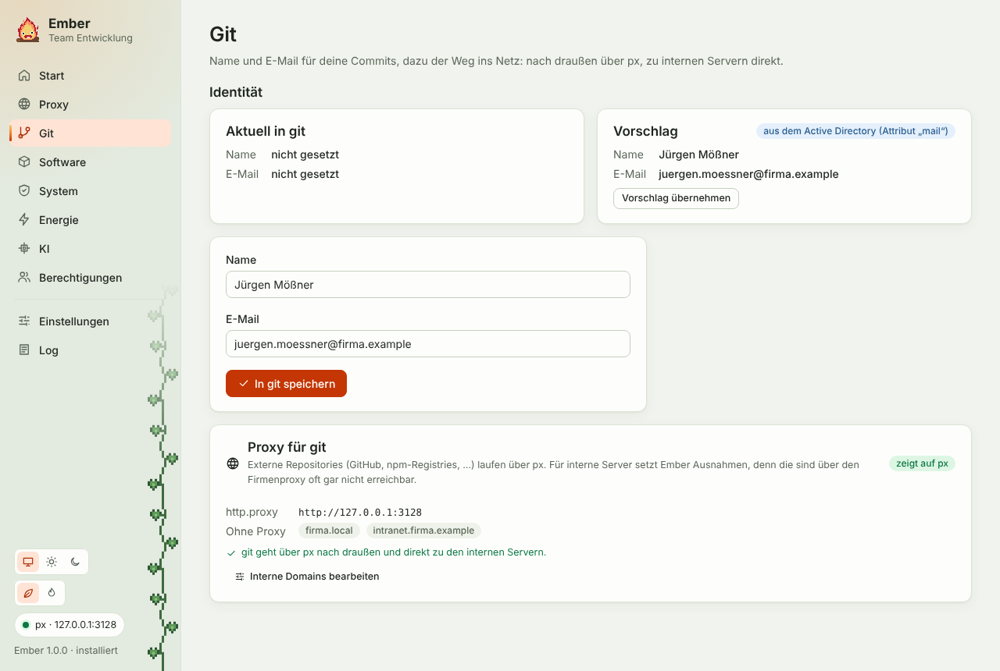

## Identität

Ember liest, was in `git config --global` für `user.name` und `user.email` steht, und macht einen Vorschlag aus deinem Windows-Konto:

- Die E-Mail kommt aus dem Active-Directory-Attribut `mail`. Ohne AD-Verbindung (kein VPN, kein Domänenrechner) nimmt Ember den Anmeldenamen (UPN), sofern er wie eine Adresse aussieht.
- Den Namen setzt Ember aus Vor- und Nachname im AD zusammen. Viele deutsche Verzeichnisse speichern den Anzeigenamen als „Nachname, Vorname (Abteilung)“, git bekommt daraus „Vorname Nachname“.

Gespeichert wird erst, wenn du auf „In git speichern“ klickst und die Rückfrage bestätigst. Umlaute im Namen kommen dabei unverändert in git an, Ember ruft git direkt auf und nicht über `cmd.exe`.

Ist git nicht installiert, verweist die Seite aufs Softwarecenter.

## Proxy und interne Server

Externe Repositories wie GitHub erreicht git über px. Interne Git-Server (GitLab, Bitbucket, Azure DevOps Server) sind über den Firmenproxy oft gar nicht erreichbar, git muss sie direkt ansprechen. Die Karte „Proxy für git“ zeigt beides: wohin `http.proxy` zeigt und für welche internen Domains git den Proxy auslässt.

„Auf px setzen“ trägt `http.proxy` ein und für jede interne Domain eine Ausnahme:

```ini
[http "https://firma.local"]
    proxy =
[http "https://*.firma.local"]
    proxy =
```

Dasselbe gibt es für `http://`. Ein leerer Proxy heißt für git: direkt verbinden. Das klappt auch, wenn px gerade nicht läuft. Der Stern deckt bei git nur eine Ebene ab (`git.firma.local`, nicht `gitlab.dev.firma.local`). Für tiefere Subdomains sorgt `NO_PROXY` in den Umgebungsvariablen, das git ebenfalls auswertet. Fehlt dort etwas, weist die Karte darauf hin.

Die internen Domains kommen aus den Einstellungen oder aus der Team-Konfiguration (`proxy.internalDomains`). „Entfernen“ unter Proxy nimmt `http.proxy` und Embers Ausnahmen wieder heraus.
