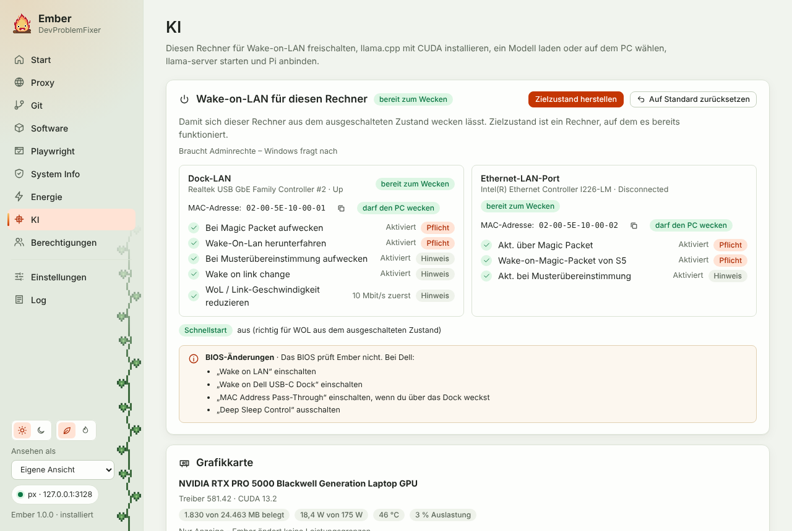

KI ist ein erweitertes Modul, genau wie Energie. Den Tab sieht nur, wer eine Rolle mit dem Modul `ai` hat (siehe [Berechtigungen](/Ember/handbuch/berechtigungen/)). <kbd>Strg</kbd> + <kbd>E</kbd> blendet ihn aus und wieder ein, Ember merkt sich das.

Die Freigabe ordnet nur die Oberfläche. Ember ist Open Source und läuft mit deinen Rechten, eine Sicherheitsgrenze ist das also nicht.

## Wake-on-LAN für diesen Rechner

Die erste Karte richtet diesen Rechner so ein, dass er sich aus dem ausgeschalteten Zustand (S5) wecken lässt. Andere Rechner weckt Ember nicht. Den Zielzustand hat Ember von einem Dell übernommen, auf dem das funktioniert: Dock mit Realtek-USB-Netzwerkkarte, dazu der Intel-I226-Anschluss im Gerät.

Für jeden kabelgebundenen Adapter prüft Ember:

| Einstellung | Ziel | Pflicht? |
|---|---|---|
| Bei Magic Packet aufwecken (`*WakeOnMagicPacket`) | an | ja |
| Wecken aus „Herunterfahren“ (`S5WakeOnLan` bei Realtek, `WakeOnMagicPacketFromS5` bei Intel, `EnablePME` bei älteren Intel-Treibern) | an | ja, falls der Treiber sie kennt |
| Gerät darf den Computer aktivieren (`powercfg /devicequery wake_armed`) | ja | ja |
| Bei Musterübereinstimmung aufwecken, Wake on link change | an | nein, Hinweis |
| WoL-Linkgeschwindigkeit | 10 Mbit/s zuerst | nein, Hinweis |

Dazu kommt der Windows-Schnellstart. Er muss aus sein, sonst fährt Windows nicht richtig herunter, und die Netzwerkkarte bekommt das Magic Packet nicht mit. Energiesparfunktionen wie EEE oder Green Ethernet lässt Ember in Ruhe, WOL braucht sie nicht.

„Zielzustand herstellen“ setzt alles mit einer einzigen Abfrage nach Adminrechten. Die Netzwerkverbindung ist dabei ein paar Sekunden weg. „Auf Standard zurücksetzen“ stellt die Treiber-Standardwerte wieder her, schaltet den Schnellstart ein und nimmt die Weck-Erlaubnis nur dort zurück, wo Ember sie selbst erteilt hat.

Die MAC-Adresse jedes Adapters lässt sich kopieren, für das Werkzeug, mit dem du den Rechner später weckst. Bei einem Dock mit MAC-Pass-Through ist das die Adresse, die Windows beim Dock-Adapter anzeigt.

:::caution[BIOS-Änderungen]
Das BIOS prüft Ember nicht. Bei Dell:

- „Wake on LAN“ einschalten
- „Wake on Dell USB-C Dock“ einschalten
- „MAC Address Pass-Through“ einschalten, wenn du über das Dock weckst
- „Deep Sleep Control“ ausschalten
:::

## Grafikkarte

Ember zeigt, was `nvidia-smi` meldet: Modell, Treiber, CUDA-Version, Speicher, Leistungsaufnahme und Temperatur. Ändern kann Ember hier nichts, Leistungsgrenzen bleiben Sache des Treibers.

## llama.cpp

„Neueste Version installieren“ holt das neueste Release von [ggml-org/llama.cpp](https://github.com/ggml-org/llama.cpp), das einen Windows-Build hat. Das „neueste“ Release von llama.cpp ist oft eines ohne Programmdateien, die Builds (`b12110` und so weiter) erscheinen als Vorabversionen. Ember sucht deshalb in den letzten 15 Releases. Die Variante:

- **CUDA**, wenn eine NVIDIA-Karte da ist. Ember nimmt den neuesten CUDA-Build innerhalb der Hauptversion, die dein Treiber kann: Ein Treiber mit CUDA 13.2 bekommt den 13.4-Build, ein Treiber mit CUDA 12.x den 12.4-Build. CUDA-13-Builds brauchen einen NVIDIA-Treiber ab Version 580.
- **Vulkan** für andere Grafikkarten.
- **CPU**, wenn es keine taugliche GPU gibt.

Bei CUDA lädt Ember zwei Zips, das Programm (`llama-bXXXXX-bin-win-cuda-13.x-x64.zip`) und die CUDA-Laufzeit (`cudart-llama-bin-win-cuda-13.x-x64.zip`). Beide prüft es gegen die SHA-256 von GitHub und entpackt sie in denselben Ordner. Danach läuft `llama-server --list-devices`: Bei CUDA muss dort `CUDA0` mit deiner Karte stehen, sonst bricht die Installation mit einem Hinweis zum Treiber ab.

Hast du schon einen llama.cpp-Ordner, der funktioniert (etwa `C:\llama` aus der Anleitung), nimmt „Vorhandenen Ordner verwenden“ ihn. Ember startet llama-server dann von dort.

Vor jedem Start fragt Ember `llama-server --list-devices` ab. Hat der Rechner eine NVIDIA-Karte und der Build sieht sie nicht, startet Ember gar nicht erst. Sonst liefe das Modell stumm auf der CPU, etwa mit einem Fünftel der Geschwindigkeit. Ins Log schreibt Ember dazu Ordner, CUDA-Dateien (`cudart64_*.dll`, `cublas64_*.dll`) und gefundene Geräte.

Du kannst die Variante auch fest einstellen. Jede Version landet in einem eigenen Ordner unter `C:\Ember\llama.cpp`. Die zwei neuesten bleiben liegen, zwischen ihnen schaltest du mit „Verwenden“ um.

Der Knopf rechts zeigt den Stand: **grün** („Neueste Version installiert“), wenn die aktive Version die neueste für diesen Rechner ist, **orange** („Update auf b…“), wenn es eine neuere gibt. Welche die neueste ist, fragt Ember höchstens einmal pro Stunde bei GitHub nach, passend zu Variante und CUDA-Version. Ohne Netz bleibt der Knopf beim normalen „Neueste Version installieren“.

## Modelle

Eingebaut ist das Modell aus der Anleitung für 24 GB VRAM: **Qwen3.8-27B** als `Qwen3.8-27B-UD-Q4_K_XL.gguf` von Unsloth (etwa 17,6 GB). Es bringt Tool-Call-Parser für MCP mit und einen MTP-Kopf, der das Generieren beschleunigt.

Zum Modell gehört das Bild-Modell `mmproj-F16.gguf` (Vision-Projektor). Ember lädt es mit und legt es als `Qwen3.8-27B-UD-Q4_K_XL.mmproj-F16.gguf` daneben. llama-server startet dann mit `--mmproj`, und das Modell liest auch Screenshots und Bilder. Fehlt es bei einem schon geladenen Modell, holt „Bild-Modell laden“ es nach. Bei einer Datei vom PC nimmt Ember eine `mmproj*.gguf` aus demselben Ordner.

Ein Modell kommt auf zwei Wegen in die Liste:

- **Download**: eine direkte Adresse, meist von Hugging Face (`…/resolve/main/datei.gguf`). Ember lädt nach `C:\Ember\Models`, über px, und setzt nach einem Abbruch fort. Steht eine SHA-256 dabei, prüft Ember sie.
- **Datei auf dem PC**: „Datei auf dem PC wählen“ nimmt eine GGUF-Datei, die schon irgendwo liegt, auch auf einem Netzlaufwerk. Ember lädt nichts herunter und löscht die Datei nie. Das Kreuz nimmt sie nur aus der Liste.

Die Team-Konfiguration kann Modelle vorgeben, mit Download-Adresse oder mit Pfad (siehe [Team-Konfiguration](/Ember/handbuch/team-konfiguration/#models)).

## llama-server

Du wählst Modell, Kontext-Profil und Port, der Rest folgt der Anleitung. Voreingestellt ist **lang**:

| Profil | Kontext | KV-Cache | MTP |
|---|---|---|---|
| standard | 96K (98.304 Token) | q8_0 | an |
| lang | 160K (163.840 Token) | q4_0 | an |
| max | 256K (262.144 Token) | q4_0 | aus |

Jedes Profil startet mit `-ngl 99` (alle Schichten auf die GPU), `-fa on`, `--jinja` und `--parallel 1`, dazu den KV-Cache des Profils (`-ctk`, `-ctv`). Was das Modell selbst braucht, hängt Ember an. Bei Qwen3.8 sind das die Sampling-Werte (`--temp 1.0 --top-p 0.95 --top-k 20 --min-p 0.0`), `reasoning_effort` medium und, wo das Profil es erlaubt, MTP (`--spec-type draft-mtp --spec-draft-n-max 2`). Unter „Weitere Argumente“ kommt dazu, was du sonst noch willst. Es steht am Ende und gewinnt deshalb.

Der Server lauscht nur auf `127.0.0.1`. Sobald das Modell geladen ist, zeigt Ember die Prüfung aus der Anleitung:

Unter „Letzte Fehlermeldung“ zeigt Ember nur Fehler. Warnungen wie `common_fit_params: failed to fit params to free device memory: n_gpu_layers already set by user to 99, abort` bleiben im Log: llama.cpp passt die Schichten nur selbst an, wenn niemand `-ngl` vorgibt, und Ember gibt `-ngl 99` vor. Der Server läuft trotzdem normal.

- **Grafikkarte**: welche GPU llama-server nutzt. Ember liest das aus dem Log und fragt zusätzlich `nvidia-smi`, ob `llama-server.exe` auf der NVIDIA rechnet. Neuere llama.cpp-Versionen schreiben die Gerätezeilen nicht mehr zuverlässig ins Log, `nvidia-smi` ist deshalb die eigentliche Antwort. Rechnet ein CUDA-Build trotzdem auf der CPU, oft weil die CUDA-Laufzeit fehlt, warnt Ember. Einen CUDA-Build ohne `cudart64_*.dll` und `cublas64_*.dll` startet Ember gar nicht erst. Er steht in der Liste mit dem Hinweis „unvollständig“ und dem Knopf „Neu installieren“. Ist „Server starten“ aus, steht der Grund daneben: kein llama.cpp, ein unvollständiger Build oder noch kein Modell.
- **Schichten auf der GPU**: steht im Log „offloaded X/Y layers to GPU“, zeigt Ember das an. Sind es nicht alle, rechnet ein Teil auf der CPU.
- **Tempo**: Token pro Sekunde beim Lesen des Prompts und beim Schreiben der Antwort, aus der letzten Anfrage.
- **Freier VRAM**: Mindestens 0,5 bis 1 GB sollten frei bleiben. Sonst ein kleineres Profil nehmen.

„Weboberfläche öffnen“ zeigt die eingebaute Chat-Seite von llama.cpp. Einen Server, den Ember selbst gestartet hat, stoppt Ember beim Beenden mit.

## llama-server ohne Ember starten

Wie bei px richtest du llama einmal in Ember ein und musst Ember danach nicht mehr öffnen. Modell und Profil, die du oben auswählst, gelten sofort, auch ohne „Server starten“. Ember schreibt sie zusammen mit dem llama.cpp-Build, dem Port und allen Argumenten nach `C:\Ember\llama.cpp\llama.json`. Daraus starten pi und das Startskript den Server genau so, wie Ember es tun würde.

**Über pi.** Nach „Mit llama-server verbinden“ in der Pi-Karte legt Ember die pi-Erweiterung `ember-llama.ts` in `%USERPROFILE%\.pi\agent\extensions` ab. Öffnest du pi mit dem lokalen Modell, passiert Folgendes:

1. Läuft llama-server schon, legt pi gleich los.
2. Sonst startet die Erweiterung ihn unsichtbar im Hintergrund. Unten in pi steht „llama lädt …“.
3. Schickst du vorher schon eine Nachricht, wartet pi, bis das Modell geladen ist.
4. Der Server läuft weiter, wenn du pi schließt. Der nächste Start geht dann sofort.

In pi gibt es dazu den Befehl `/llama`: ohne Zusatz zeigt er den Stand, `/llama start` startet den Server, `/llama stop` beendet ihn und gibt den Grafikspeicher frei. Das Log des Servers steht in `C:\Ember\Logs\llama-server.log`. Bricht der Start ab, zeigt pi die letzte Fehlerzeile daraus.

**Über das Startskript.** `C:\Ember\llama.cpp\llama-server starten.cmd` startet den Server in einem Konsolenfenster, zum Beispiel im Terminal von VS Code oder über das Startmenü unter „llama-server (Ember)“. Strg+C beendet ihn. Läuft schon einer, etwa von pi gestartet, sagt das Skript das und startet keinen zweiten.

Ember zeigt einen so gestarteten Server mit „außerhalb von Ember gestartet“ an. „Server stoppen“ beendet ihn auch dann.

## Pi

[Pi](https://www.npmjs.com/package/@earendil-works/pi-coding-agent) ist ein Coding-Agent, der den llama-server über die OpenAI-kompatible API anspricht.

- **Pi installieren** führt `npm install -g @earendil-works/pi-coding-agent` aus und danach `pi install npm:pi-mcp-adapter`, beides über px und mit den Firmenzertifikaten. Dafür braucht es Node.js, das du unter Software installierst.
- **Mit llama-server verbinden** trägt in `%USERPROFILE%\.pi\agent\models.json` den Provider `llama-cpp` ein: `http://127.0.0.1:<Port>/v1`, das Modell mit seinem Alias und `contextWindow` passend zum Profil. Andere Provider in der Datei bleiben, die alte Fassung liegt daneben als `models.json.bak`. Wechselst du das Profil, verbindest du noch einmal, damit Pi weiß, wann es den Verlauf zusammenfassen muss.

Hat das Modell ein Bild-Modell, trägt Ember bei `input` auch `image` ein, Pi kann dann Bilder schicken.

Unter **Erweiterungen** stehen Pakete für Pi, jeweils mit installierter und neuester Version. „Installieren“ führt `pi install npm:…` über px aus, „Aktualisieren“ holt die neue Version. Pi selbst bekommt denselben Knopf, wenn npm eine neuere Version kennt.

| Erweiterung | Paket | Wofür |
|---|---|---|
| MCP | `pi-mcp-adapter` | MCP-Server aus der `.mcp.json` |
| Websuche | `pi-web-access` | Suchen und Seiten lesen, auch mit dem lokalen llama.cpp-Modell. Sucht ohne Schlüssel (Exa, DuckDuckGo); Ember trägt px als `proxy` in `~/.pi/agent/web-search.json` ein |
| Pretty | `@heyhuynhgiabuu/pi-pretty` | farbige Ausgabe mit Syntaxhervorhebung |
| Ponytail | `@dietrichgebert/ponytail` | schreibt nur den nötigen Code |
| Simplify | `pi-simplify` | prüft geänderten Code auf Einfachheit |
| Context Mode | `context-mode` | spart Kontext bei langen Ausgaben |
| Todo | `@juicesharp/rpiv-todo` | Aufgabenliste für das Modell |

Zur Websuche: `pi-web-access` ist ein Werkzeug, das das Modell aufruft. Deshalb sucht es auch mit dem lokalen Modell, anders als Pakete, die die Suche des Cloud-Anbieters nutzen. Ohne Schlüssel sucht es über Exa und DuckDuckGo, mit Schlüssel auch über Brave, Tavily und andere. Node schickt seine Anfragen nicht über `HTTPS_PROXY`, deshalb trägt Ember beim Installieren und bei „Mit llama-server verbinden“ px als `proxy` in `%USERPROFILE%\.pi\agent\web-search.json` ein. Ein eigener Proxy, der nicht auf `localhost` zeigt, bleibt stehen.

Gestartet wird im Projektordner mit `pi --provider llama-cpp --model qwen3.8-27b`. Die MCP-Server liest Pi aus der `.mcp.json` des Repos und aus `%USERPROFILE%\.pi\agent\mcp.json`. Schalte nur die ein, die du gerade brauchst, jede Tool-Beschreibung kostet Kontext.
