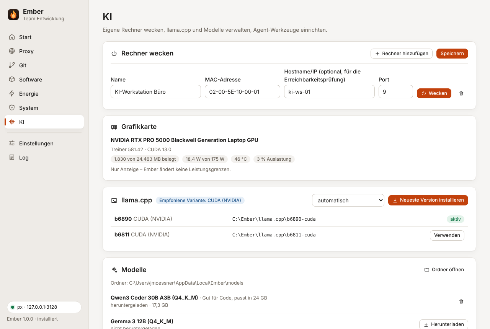

Das KI-Modul ist ein erweitertes Modul. Es erscheint, wenn du in den Einstellungen „Erweiterte Module anzeigen“ einschaltest oder <kbd>Strg</kbd> + <kbd>Umschalt</kbd> + <kbd>E</kbd> drückst und die Team-Konfiguration es für dein Konto freigibt (`modules.ai`). Ohne Einträge dort ist es für alle freigegeben.

Die Freigabe blendet nur die Oberfläche aus und ein. Ember ist Open Source, das ist also keine Sicherheitsgrenze. Sie hält die Oberfläche für alle anderen aufgeräumt.

## Rechner wecken

Trag Name, MAC-Adresse und optional Hostname oder IP ein. „Wecken“ schickt das Magic Packet über jede aktive Netzwerkverbindung, an `255.255.255.255` und an die Broadcast-Adresse des jeweiligen Netzes. Mit Hostnamen pingt Ember danach bis zu drei Minuten lang und meldet, sobald der Rechner antwortet. Etwa alle 30 Sekunden geht ein neues Paket raus.

Damit der Zielrechner aufwacht, muss er vorbereitet sein. Das erledigt auf dem Zielrechner die [Wake-on-LAN-Karte unter Energie](/Ember/handbuch/energie/#wake-on-lan-für-diesen-rechner).

## Grafikkarte

Ember zeigt, was `nvidia-smi` meldet: Modell, Treiber, CUDA-Version, Speicher, Leistungsaufnahme, Temperatur. Ändern kann Ember hier nichts, Leistungsgrenzen bleiben Sache des Treibers.

## llama.cpp

„Neueste Version installieren“ holt das aktuelle Release von [ggml-org/llama.cpp](https://github.com/ggml-org/llama.cpp) und wählt die passende Windows-Variante:

- CUDA, wenn eine NVIDIA-Karte da ist. Ember nimmt die höchste CUDA-Version, die dein Treiber unterstützt, und lädt die passenden CUDA-Laufzeitbibliotheken mit.
- Vulkan für andere Grafikkarten.
- CPU, wenn es keine taugliche GPU gibt.

Du kannst die Variante auch fest einstellen. Jede Version landet in einem eigenen Ordner unter `C:\Ember\llama.cpp`. Die zwei neuesten bleiben liegen, zwischen ihnen schaltest du mit „Verwenden“ um.

## Modelle

Modelle sind GGUF-Dateien mit einer direkten Download-Adresse, meist von Hugging Face (`…/resolve/main/datei.gguf`). Die Liste kommt aus der Team-Konfiguration und aus deinen eigenen Einträgen. Downloads laufen über px und setzen nach einem Abbruch dort fort, wo sie aufgehört haben. Bei 20 GB macht das einen Unterschied. Steht eine SHA256-Prüfsumme dabei, prüft Ember sie nach dem Download.

## llama-server

Wähle ein heruntergeladenes Modell, einen Port und bei Bedarf weitere Argumente (Standard: `-ngl 99 -c 8192`). Der Server lauscht nur auf `127.0.0.1`. „Weboberfläche öffnen“ zeigt die eingebaute Chat-Seite von llama.cpp. Beim Beenden von Ember stoppt der Server mit.

## Agent-Werkzeuge

Agent-CLIs wie Claude Code installiert Ember mit `npm install -g`. Das läuft über px wie jeder andere npm-Aufruf. Die Liste zeigt installierte und neueste Version. Eigene Pakete fügst du unten hinzu. Erlaubt sind nur gültige npm-Paketnamen, weil der Aufruf über `cmd.exe` läuft.
