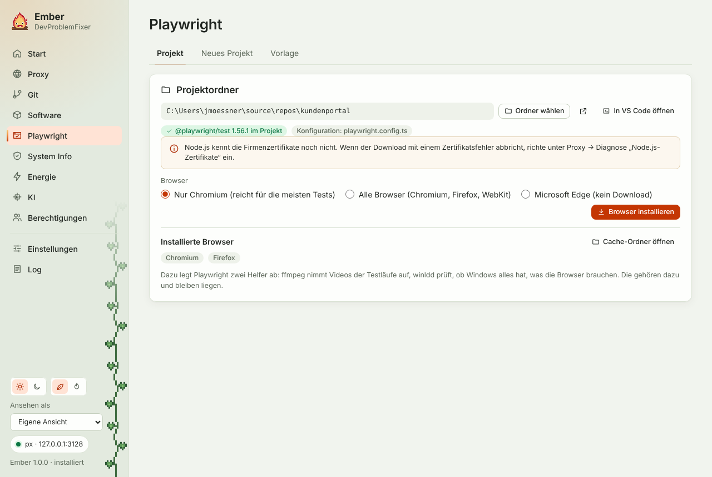

Playwright gehört zum Projekt, als npm-Paket in der `package.json`. Die Browser liegen dagegen in einem gemeinsamen Cache unter `%LOCALAPPDATA%\ms-playwright`, ein Ordner pro Browser-Version. Jede Playwright-Version braucht ihre eigenen Browser-Builds, deshalb arbeitet Ember immer mit einem Projektordner.

## Browser für ein Projekt

1. Projektordner wählen. Ember zeigt, welches Playwright das Projekt nutzt und welche `playwright.config` es hat.
2. Browser wählen: nur Chromium, alle Browser oder Microsoft Edge (kein Download).
3. „Browser installieren“ führt im Projekt aus: bei Bedarf `npm ci` (oder `npm install`), danach `npx playwright install chromium` oder für alle Browser `npx playwright install`.

Dabei setzt Ember, woran es hinter einem Firmenproxy meistens scheitert:

- `HTTPS_PROXY` und `HTTP_PROXY` auf px, `NO_PROXY` auf die internen Domains
- `NODE_EXTRA_CA_CERTS`, wenn unter Proxy → Diagnose die Node.js-Zertifikate eingerichtet sind
- `PLAYWRIGHT_DOWNLOAD_HOST`, wenn die Team-Konfiguration einen internen Spiegel nennt (`playwright.downloadHost`)

Bricht der Download ab, sagt Ember, woran es lag. Ein Zertifikatsfehler heißt: Der Proxy bricht TLS auf, die Node.js-Zertifikate fehlen. Ein 407 heißt: px läuft nicht. Ist der Server nicht erreichbar, ist `cdn.playwright.dev` vermutlich gesperrt.

Unter „Installierte Browser“ zeigt Ember, was im Cache liegt: Chromium, Firefox, WebKit. Die Ordnernamen mit Build-Nummer stehen im Tooltip. Zwei weitere Ordner legt Playwright immer mit ab: `ffmpeg` nimmt Videos der Testläufe auf, `winldd` prüft, ob Windows alles hat, was die Browser brauchen. Die gehören dazu, Ember zeigt sie nicht als Browser an. Dasselbe gilt für `chromium_headless_shell`, den Chromium für Läufe ohne Fenster.

## Wenn der Download nicht klappt: Edge

Microsoft Edge ist auf jedem Windows-Rechner installiert, und Playwright kann ihn statt eines heruntergeladenen Chromium nehmen (`channel: 'msedge'`). Scheitert der Browser-Download, bietet Ember darunter „Edge verwenden“ an. Dasselbe passiert mit der Browser-Wahl „Microsoft Edge (kein Download)“.

- Hat das Projekt noch keine `playwright.config`, legt Ember eine `playwright.config.ts` für Edge an. Die Tests laufen dann mit `npm test`.
- Gibt es schon eine, bleibt sie unverändert. Ember legt daneben `playwright.msedge.config.ts` an (bei JavaScript-Projekten `.mjs`). Die übernimmt alles aus der vorhandenen Konfiguration und stellt nur die Chromium-Projekte auf Edge um. Firefox und WebKit lässt sie weg, die bräuchten einen Download. Dazu kommt das npm-Skript `test:edge`, gestartet wird also mit `npm run test:edge`.

Nutzt ein Projekt Playwright ohne Test-Runner (Paket `playwright` statt `@playwright/test`), gibt es keine Konfigurationsdatei. Ember zeigt dann die Zeile, mit der man Edge im Code startet: `chromium.launch({ channel: 'msedge' })`.

## Playwright hinzufügen

Steht im gewählten Ordner noch kein Playwright in der `package.json`, heißt der Knopf „Playwright hinzufügen“. Nach einer Rückfrage:

1. `npm init -y`, falls es noch gar keine `package.json` gibt,
2. `npm install -D @playwright/test @types/node` in der neuesten Version,
3. fehlt eine `playwright.config`, kommen Konfiguration und Beispieltest aus der Ember-Vorlage dazu,
4. die üblichen Einträge in der `.gitignore` und die npm-Skripte, die noch fehlen.

Danach installiert Ember wie oben die Browser oder richtet Edge ein. Vorhandene Dateien und Skripte bleiben, wie sie sind.

## Neues Projekt aus der Ember-Vorlage

„Neues Projekt“ legt ein fertiges Playwright-Projekt an. Du wählst den Speicherort (vorgeschlagen ist der Ordner neben dem aktuellen Projekt oder `%USERPROFILE%\source\repos`) und gibst einen Namen ein. Der Name folgt den npm-Regeln, aus „Mein Projekt“ wird `mein-projekt`.

Die Vorlage entspricht dem, was `npm init playwright` anlegt:

| Datei | Inhalt |
|---|---|
| `package.json` | Skripte `test`, `test:ui`, `test:headed`, `report`, `codegen` |
| `playwright.config.ts` | Tests in `tests/`, HTML-Bericht ohne automatisches Öffnen, Trace beim ersten Wiederholen, Screenshot bei Fehlern, Projekte je nach Browser-Wahl |
| `tests/example.spec.ts` | der Beispieltest von Playwright |
| `.gitignore` | `node_modules`, Testergebnisse, Berichte |
| `.vscode/extensions.json` | Empfehlung für die Playwright-Erweiterung |
| `README.md` | die wichtigsten Befehle |

Danach installiert npm `@playwright/test`, und Ember lädt die Browser oder richtet Edge ein. Mit „In VS Code öffnen“ geht es direkt weiter.
