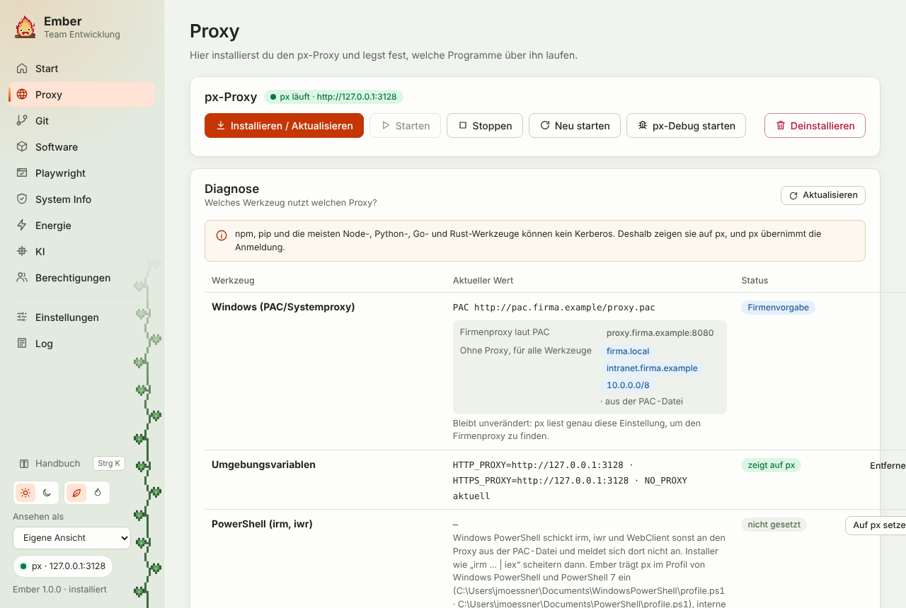

## Das Problem, das px löst

Der Firmenproxy will wissen, wer du bist. Browser und Windows erledigen das per Kerberos mit deinem Windows-Login. npm, pip und die meisten Node-, Python-, Go- und Rust-Werkzeuge können das nicht. git und .NET könnten es, aber nur mit Zusatzkonfiguration.

Die übliche Notlösung ist, Benutzername und Passwort in `.npmrc` oder `pip.ini` zu schreiben. Damit liegt dein Passwort im Klartext auf der Platte, und nach jeder Passwortänderung bricht alles.

[px](https://github.com/genotrance/px) läuft lokal auf `127.0.0.1:3128`. Deine Werkzeuge sprechen ohne Anmeldung mit px, und px meldet sich per Kerberos beim Firmenproxy an. Ember speichert keine Passwörter. Es sorgt dafür, dass keine nötig sind.

## Installieren und aktualisieren

„Installieren / Aktualisieren“ führt diese Schritte aus:

| Schritt | Was passiert |
|---|---|
| Proxy und PAC-Datei ermitteln | PAC-Adresse aus den Einstellungen oder aus Windows, TCP-Test zum Firmenproxy |
| px-Release ermitteln, herunterladen | neueste Windows-Version von GitHub, über den Firmenproxy mit deinem Windows-Login |
| SHA256-Prüfsumme prüfen | gegen die `.sha256`-Datei des Releases |
| Entpacken, `px.ini` schreiben | nach `C:\Ember\px`, die alte `px.ini` wird als `px.ini.bak` gesichert |
| Autostart, px starten, Verbindungstest | px startet beim Login, Test gegen github.com über px |
| Werkzeuge umstellen | Umgebungsvariablen, git, npm, NuGet und pip zeigen auf px |

Jeder erneute Lauf aktualisiert px auf die neueste Version. Ein lokales px-Zip (Einstellungen → px) ersetzt den Download, falls GitHub gesperrt ist.

Ändert jemand in der Team-Konfiguration den Proxy, erscheint unter Proxy der Hinweis „px-Konfiguration veraltet“. Ein Klick auf „Installieren / Aktualisieren“ bringt sie auf den neuen Stand.

## Die Diagnose-Tabelle

Die Tabelle zeigt pro Werkzeug den aktuellen Proxy und einen Status:

- **zeigt auf px**: alles richtig.
- **zeigt woanders hin**: zum Beispiel ein alter Eintrag mit dem Firmenproxy direkt. „Auf px setzen“ ändert ihn nach Rückfrage.
- **nicht gesetzt**: das Werkzeug geht ohne Proxy raus, was im Firmennetz meist scheitert.
- **Firmenvorgabe**: die Windows-Einstellung (PAC-Datei). Die bleibt, wie sie ist, denn px liest genau sie.

Nach jeder Installation, Deinstallation oder Reparatur von px liest Ember die Tabelle von selbst neu.

„Auf px setzen“ geht nur, solange px installiert ist und läuft. Sonst ist der Knopf ausgegraut, denn ein Werkzeug, das auf ein fehlendes px zeigt, kommt gar nicht mehr ins Netz. Dasselbe gilt für den Knopf auf der Git-Seite.

Folgende Werkzeuge kennt Ember:

| Werkzeug | Wo Ember liest und schreibt |
|---|---|
| Umgebungsvariablen | `HTTP_PROXY`, `HTTPS_PROXY`, `NO_PROXY` für dein Benutzerkonto |
| PowerShell (irm, iwr) | ein Block in `Dokumente\WindowsPowerShell\profile.ps1` und `Dokumente\PowerShell\profile.ps1`, siehe unten |
| git | `git config --global http.proxy`, dazu für jede interne Domain `http.<url>.proxy` leer und `http.<url>.allowNTLMAuth true` |
| npm | `npm config` (`proxy`, `https-proxy`, `noproxy`) |
| Node.js-Zertifikate | `NODE_EXTRA_CA_CERTS` für dein Benutzerkonto, zeigt auf `C:\Ember\Certs\windows-ca.pem` |
| NuGet / .NET | `http_proxy` und `no_proxy` in `%APPDATA%\NuGet\NuGet.Config` |
| pip | `proxy` in `%APPDATA%\pip\pip.ini` |
| VS Code | `"http.proxy"` und `"http.noProxy"` in `settings.json`, Kommentare bleiben erhalten |

### PowerShell

Windows PowerShell 5.1 schickt `Invoke-WebRequest`, `Invoke-RestMethod` (`irm`) und `WebClient` an den Proxy aus der PAC-Datei, meldet sich dort aber nicht an. Die Umgebungsvariablen beachtet es nicht. Installer wie

```powershell
powershell -c "irm https://pi.dev/install.ps1 | iex"
```

scheitern deshalb, in PowerShell genauso wie aus `cmd` heraus. „Auf px setzen“ trägt in das Profil von Windows PowerShell und PowerShell 7 einen Block ein, der genau diese Aufrufe über px schickt. Interne Domains und `localhost` gehen direkt. Was sonst im Profil steht, bleibt, wie es ist. Neue PowerShell-Fenster nutzen den Eintrag.

Windows PowerShell lädt Profile nur mit der Ausführungsrichtlinie RemoteSigned. Steht sie auf „Restricted“ (der Windows-Standard), sagt die Diagnose das dazu. Umstellen kannst du sie unter [System](/Ember/handbuch/system/).

## Interne Server ohne Proxy

Interne Server sind über den Firmenproxy oft nicht erreichbar, oder der Umweg kostet nur Zeit. Die internen Domains bekommt deshalb jedes Werkzeug als Ausnahme, und zwar in dem Format, das es versteht. Sie kommen aus den Einstellungen, sonst aus der Team-Konfiguration (`proxy.internalDomains`), sonst aus der PAC-Datei: Ember liest, welche Ziele sie mit `DIRECT` am Proxy vorbeischickt (`dnsDomainIs`, `shExpMatch`, `isInNet` und Co.).

| Wo | Was Ember einträgt (Beispiel `firma.local`) |
|---|---|
| px | `noproxy = firma.local,*.firma.local`: px verbindet direkt statt über den Firmenproxy |
| `NO_PROXY` | `localhost,127.0.0.1,::1,firma.local`, gilt für git, npm, pip, Python, Node.js und viele CLIs |
| npm | `noproxy` wie `NO_PROXY` |
| git | `http.https://firma.local.proxy` und `http.https://*.firma.local.proxy` leer, dasselbe für `http://`, dazu `allowNTLMAuth`, siehe [Git](/Ember/handbuch/git/#proxy-und-interne-server) |
| NuGet | `no_proxy` wie `NO_PROXY` |
| VS Code | `"http.noProxy": ["localhost", "127.0.0.1", "::1", "firma.local"]` |
| pip | `pip.ini` kennt keine Ausnahmen, pip nimmt `NO_PROXY` |

Die Liste steht in der Diagnose einmal, in der Zeile „Windows (PAC/Systemproxy)“: daneben der Firmenproxy laut PAC-Datei und woher die Ausnahmen kommen. Bei den einzelnen Werkzeugen steht nur, ob ihre Ausnahmen aktuell sind, veraltet oder fehlen.

Ob du `firma.local`, `.firma.local` oder `*.firma.local` einträgst, ist egal: Ember meint damit immer die Domain und alles darunter. IP-Bereiche wie `10.0.0.0/8` gehen unverändert durch. Ändern sich die Domains, zeigt die Diagnose bei git, NuGet und VS Code „Auf px setzen“ wieder an. Ein Klick bringt die Ausnahmen auf den neuen Stand.

„Entfernen“ nimmt nur Einträge zurück, die auf px zeigen. Was jemand anders eingetragen hat, bleibt stehen. Das gilt auch für die Deinstallation.

Die Zeile „Node.js-Zertifikate“ ist kein Proxy-Eintrag, gehört aber zum selben Problem. Node.js, und damit npm, npx, Playwright und viele CLIs, kennt den Windows-Zertifikatsspeicher nicht. Bricht der Firmenproxy TLS auf, scheitern Downloads mit „unable to get local issuer certificate“. „Einrichten“ exportiert die vertrauenswürdigen Stamm- und Zwischenzertifikate von Windows in eine PEM-Datei und setzt `NODE_EXTRA_CA_CERTS`. „Erneuern“ schreibt die Datei neu, etwa nachdem die IT ein Zertifikat getauscht hat.

## px steuern

Starten, Stoppen und Neustarten machen, was sie sagen. „px-Debug starten“ startet px in einem eigenen Konsolenfenster mit ausführlicher Ausgabe, live zum Mitlesen. Ember schreibt dieselbe Ausgabe in `C:\Ember\Logs\px-debug-JJJJMMTT-HHMMSS.log`. Damit findest du fast jeden Fehler, zum Beispiel eine 407-Antwort vom Firmenproxy, wenn Kerberos nicht klappt.

Beenden kannst du px-Debug in Ember („px-Debug beenden“) oder indem du das Fenster schließt. Danach öffnet Ember den Explorer mit der Logdatei markiert, und das normale px läuft wieder.
