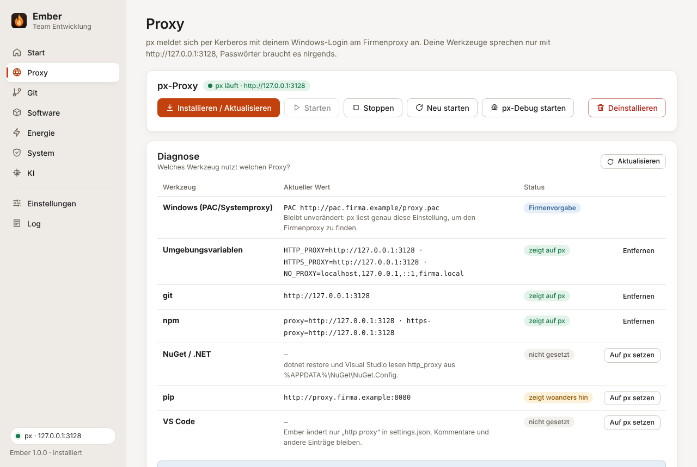

## Das Problem, das px löst

Der Firmenproxy will wissen, wer du bist. Browser und Windows erledigen das per Kerberos mit deinem Windows-Login. npm, pip und die meisten Node-, Python-, Go- und Rust-Werkzeuge können das nicht. git und .NET könnten es, aber nur mit Zusatzkonfiguration.

Die übliche Notlösung ist, Benutzername und Passwort in `.npmrc` oder `pip.ini` zu schreiben. Damit liegt dein Passwort im Klartext auf der Platte, und nach jeder Passwortänderung bricht alles.

[px](https://github.com/genotrance/px) läuft lokal auf `127.0.0.1:3128`. Deine Werkzeuge sprechen ohne Anmeldung mit px, und px meldet sich per Kerberos beim Firmenproxy an. Ember speichert keine Passwörter. Es sorgt dafür, dass keine nötig sind.

## Installieren und aktualisieren

„Installieren / Aktualisieren“ führt diese Schritte aus:

| Schritt | Was passiert |
|---|---|
| Proxy und PAC-Datei ermitteln | PAC-Adresse aus den Einstellungen oder aus Windows, TCP-Test zum Firmenproxy |
| px-Release ermitteln, herunterladen | neueste Windows-Version von GitHub, über den Firmenproxy mit deinem Windows-Login |
| SHA256-Prüfsumme prüfen | gegen die `.sha256`-Datei des Releases |
| Entpacken, `px.ini` schreiben | nach `C:\Ember\px`, die alte `px.ini` wird als `px.ini.bak` gesichert |
| Autostart, px starten, Verbindungstest | px startet beim Login, Test gegen github.com über px |
| Werkzeuge umstellen | Umgebungsvariablen, git, npm, NuGet und pip zeigen auf px |

Jeder erneute Lauf aktualisiert px auf die neueste Version. Ein lokales px-Zip (Einstellungen → px) ersetzt den Download, falls GitHub gesperrt ist.

Ändert jemand in der Team-Konfiguration den Proxy, erscheint unter Proxy der Hinweis „px-Konfiguration veraltet“. Ein Klick auf „Installieren / Aktualisieren“ bringt sie auf den neuen Stand.

## Die Diagnose-Tabelle

Die Tabelle zeigt pro Werkzeug den aktuellen Proxy und einen Status:

- **zeigt auf px**: alles richtig.
- **zeigt woanders hin**: zum Beispiel ein alter Eintrag mit dem Firmenproxy direkt. „Auf px setzen“ ändert ihn nach Rückfrage.
- **nicht gesetzt**: das Werkzeug geht ohne Proxy raus, was im Firmennetz meist scheitert.
- **Firmenvorgabe**: die Windows-Einstellung (PAC-Datei). Die bleibt, wie sie ist, denn px liest genau sie.

Folgende Werkzeuge kennt Ember:

| Werkzeug | Wo Ember liest und schreibt |
|---|---|
| Umgebungsvariablen | `HTTP_PROXY`, `HTTPS_PROXY`, `NO_PROXY` für dein Benutzerkonto |
| git | `git config --global http.proxy` |
| npm | `npm config` (`proxy`, `https-proxy`, `noproxy`) |
| NuGet / .NET | `http_proxy` in `%APPDATA%\NuGet\NuGet.Config` |
| pip | `proxy` in `%APPDATA%\pip\pip.ini` |
| VS Code | `"http.proxy"` in `settings.json`, Kommentare bleiben erhalten |

„Entfernen“ nimmt nur Einträge zurück, die auf px zeigen. Was jemand anders eingetragen hat, bleibt stehen. Das gilt auch für die Deinstallation.

## px steuern

Starten, Stoppen und Neustarten machen, was sie sagen. „px-Debug starten“ startet px im Vordergrund mit ausführlichem Log. Die Ausgabe steht im Log-Tab mit der Quelle „px“. Damit findest du fast jeden Fehler, zum Beispiel eine 407-Antwort vom Firmenproxy, wenn Kerberos nicht klappt. Beim Beenden ersetzt Ember das Debug-px automatisch wieder durch das normale.
