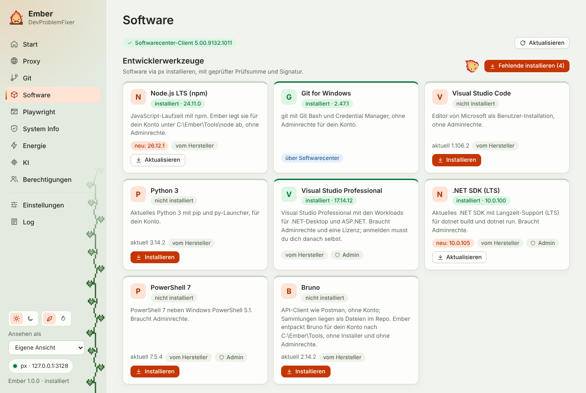

Die Seite besteht aus Kacheln in zwei Gruppen: die Entwicklerwerkzeuge und alles, was das Softwarecenter auf deinem Rechner anbietet. Eine Kachel mit grüner Oberkante ist erledigt, das Programm ist installiert und aktuell. Playwright hat einen [eigenen Tab](/Ember/handbuch/playwright/).

## Entwicklerwerkzeuge

Der Grundstock für die Entwicklung:

| Werkzeug | Woher, wenn es kein Softwarecenter-Paket gibt | Adminrechte? |
|---|---|---|
| Node.js LTS (mit npm) | Zip von nodejs.org, entpackt nach `C:\Ember\Tools\node`, dazu `C:\Ember\Tools\node` und `%APPDATA%\npm` im Benutzer-PATH | nein |
| Git for Windows | Installer von GitHub (git-for-windows), Installation für dein Konto | nein (außer Git ist schon für alle Benutzer installiert) |
| Visual Studio Code | User Setup von Microsoft | nein |
| Python 3 | Installer von python.org, für dein Konto, mit `py`-Launcher und PATH | nein |
| Visual Studio Professional | Bootstrapper von Microsoft, Workloads .NET-Desktop und ASP.NET | ja |
| .NET SDK (LTS) | Installer aus den Release-Daten von Microsoft | ja |
| PowerShell 7 | MSI von GitHub (PowerShell/PowerShell) | ja |
| Bruno (API-Client) | Zip von GitHub (usebruno/bruno), entpackt nach `C:\Ember\Tools\bruno`, mit Eintrag im Startmenü | nein |

Stellt eure IT ein Werkzeug im Softwarecenter bereit, nimmt Ember dieses Paket. Sonst lädt Ember den offiziellen Installer über px und prüft ihn, bevor er läuft: die Prüfsumme, die der Hersteller veröffentlicht (nodejs.org, VS Code, .NET, GitHub), und die digitale Signatur des Herstellers. Passt etwas nicht, löscht Ember die Datei und installiert nichts. Bei Bruno nimmt Ember das Zip statt des Installers, weil der Installer bei einer Neuinstallation für ein einzelnes Konto abstürzt (Exit-Code -1073741819). Das Zip prüft Ember gegen die SHA-256, die GitHub zu jeder Datei veröffentlicht. Läuft Bruno beim Aktualisieren noch, bittet Ember dich, es zu schließen. Auf jeder Kachel stehen die installierte und die aktuelle Version. „Aktualisieren“ erscheint nur, wenn es wirklich etwas Neueres gibt.

„Fehlende installieren“ arbeitet alle fehlenden Werkzeuge in einem Durchgang ab. Bei Visual Studio, .NET SDK und PowerShell 7 fragt Windows jeweils nach Adminrechten. Visual Studio lädt seine Workloads selbst nach, das dauert je nach Leitung 20 bis 60 Minuten. Nach der Installation finden neu geöffnete Konsolen die Werkzeuge über den PATH.

Die Team-Konfiguration kann die Liste einschränken, die Direktinstallation abschalten (dann bleibt nur Softwarecenter oder Service-Center) und für Visual Studio Bootstrapper und Workloads festlegen, siehe [Team-Konfiguration](/Ember/handbuch/team-konfiguration/#devtools).

## Programme aus dem Softwarecenter

Ember zeigt alles, was der Configuration-Manager-Client auf deinem Rechner anbietet, als Kachel. Pro Paket gibt es eine Kachel. Hat ein Paket mehrere Programme, nimmt Ember das Installationsprogramm und lässt Deinstallieren oder Reparieren weg. Was schon eine Werkzeug-Kachel abdeckt (etwa Git oder VS Code), erscheint nicht doppelt.

Die Liste `software` in der Team-Konfiguration ist dafür nicht nötig. Sie sortiert Programme unter eine Überschrift (`category`) und ergänzt eine Notiz. Alles andere steht unter „Weitere im Softwarecenter“. Ab neun Kacheln gibt es ein Suchfeld.

Installiert wird nur über den Client, nie an der IT vorbei.

### Was jede Kachel zeigt

- Ob das Programm installiert ist und in welcher Version. Das liest Ember aus „Programme und Features“ (die Uninstall-Einträge der Registry) und gleicht den Namen ohne Versionsnummern und Architektur ab.
- Ob das Softwarecenter es als Paket oder als Anwendung anbietet, und in welchem Zustand.
- „Installieren“, dazu klein „Im Softwarecenter öffnen“ und „Beim Service-Center anfragen“.

### Pakete und Anwendungen

Configuration Manager kennt zwei Arten der Verteilung:

- **Pakete** (Paket-ID plus Programm) sind bei vielen Firmen der Normalfall. „Installieren“ bittet den Client per `CCM_ProgramsManager.ExecuteProgram`, das Programm auszuführen. Das ist dasselbe wie der Knopf im Softwarecenter, mit denselben Rechten und Wartungsfenstern. Ember verfolgt danach den Status und meldet „installiert“, „Neustart nötig“ oder einen Fehler.
- **Anwendungen** öffnet Ember per Direktlink `softwarecenter:SoftwareID=…` im Softwarecenter.

### Wenn der Direktlink fehlt

Für Pakete gibt es kein verlässliches Link-Format. „Im Softwarecenter öffnen“ zeigt dann die Startseite „Verfügbare Software“ und nennt den Paketnamen. Wer einen festen Link möchte: Im Softwarecenter die App öffnen, über „Teilen“ den Link kopieren (falls die Version das anbietet) und in `team.json` als `softwareCenterLink` eintragen.

### Ohne Softwarecenter oder ohne Freigabe

„Beim Service-Center anfragen“ öffnet die vorbereitete Mail „Software anfordern“ mit Programmname, Benutzer und Rechner. Mehr dazu unter [Service-Center](/Ember/handbuch/service-center/).
