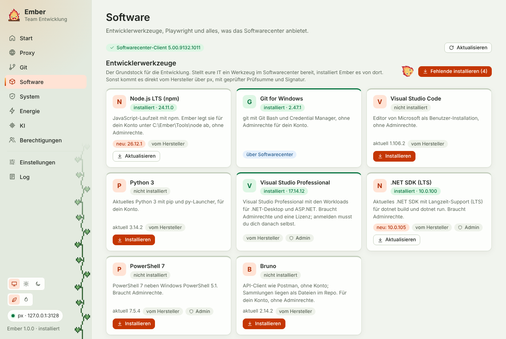

Die Seite besteht aus Kacheln in drei Gruppen: die Entwicklerwerkzeuge, Playwright und alles, was das Softwarecenter auf deinem Rechner anbietet. Eine Kachel mit grüner Oberkante ist erledigt, das Programm ist installiert und aktuell.

## Entwicklerwerkzeuge

Der Grundstock für die Entwicklung:

| Werkzeug | Woher, wenn es kein Softwarecenter-Paket gibt | Adminrechte? |
|---|---|---|
| Node.js LTS (mit npm) | Zip von nodejs.org, entpackt nach `C:\Ember\Tools\node`, dazu `C:\Ember\Tools\node` und `%APPDATA%\npm` im Benutzer-PATH | nein |
| Git for Windows | Installer von GitHub (git-for-windows), Installation für dein Konto | nein (außer Git ist schon für alle Benutzer installiert) |
| Visual Studio Code | User Setup von Microsoft | nein |
| Python 3 | Installer von python.org, für dein Konto, mit `py`-Launcher und PATH | nein |
| Visual Studio Professional | Bootstrapper von Microsoft, Workloads .NET-Desktop und ASP.NET | ja |
| .NET SDK (LTS) | Installer aus den Release-Daten von Microsoft | ja |
| PowerShell 7 | MSI von GitHub (PowerShell/PowerShell) | ja |
| Bruno (API-Client) | Installer von GitHub (usebruno/bruno), für dein Konto | nein |

Stellt eure IT ein Werkzeug im Softwarecenter bereit, nimmt Ember dieses Paket. Sonst lädt Ember den offiziellen Installer über px und prüft ihn, bevor er läuft: die Prüfsumme, die der Hersteller veröffentlicht (nodejs.org, VS Code, .NET, GitHub), und die digitale Signatur des Herstellers. Passt etwas nicht, löscht Ember die Datei und installiert nichts. Bruno signiert seinen Windows-Installer nicht. Ember nimmt ihn deshalb nur, wenn die SHA-256 von GitHub passt. Auf jeder Kachel stehen die installierte und die aktuelle Version. „Aktualisieren“ erscheint nur, wenn es wirklich etwas Neueres gibt.

„Fehlende installieren“ arbeitet alle fehlenden Werkzeuge in einem Durchgang ab. Bei Visual Studio, .NET SDK und PowerShell 7 fragt Windows jeweils nach Adminrechten. Visual Studio lädt seine Workloads selbst nach, das dauert je nach Leitung 20 bis 60 Minuten. Nach der Installation finden neu geöffnete Konsolen die Werkzeuge über den PATH.

Die Team-Konfiguration kann die Liste einschränken, die Direktinstallation abschalten (dann bleibt nur Softwarecenter oder Service-Center) und für Visual Studio Bootstrapper und Workloads festlegen, siehe [Team-Konfiguration](/Ember/handbuch/team-konfiguration/#devtools).

## Playwright

Playwright gehört zum Projekt, als npm-Paket in der `package.json`. Die Browser liegen dagegen in einem gemeinsamen Cache unter `%LOCALAPPDATA%\ms-playwright`, ein Ordner pro Browser-Version. Jede Playwright-Version braucht ihre eigenen Browser-Builds, deshalb arbeitet Ember immer mit einem Projektordner.

### Browser für ein Projekt

1. Projektordner wählen. Ember zeigt, welches Playwright das Projekt nutzt und welche `playwright.config` es hat.
2. Browser wählen: nur Chromium, alle Browser oder Microsoft Edge (kein Download).
3. „Browser installieren“ führt im Projekt aus: bei Bedarf `npm ci` (oder `npm install`), danach `npx playwright install chromium` oder für alle Browser `npx playwright install`.

Dabei setzt Ember, woran es hinter einem Firmenproxy meistens scheitert:

- `HTTPS_PROXY` und `HTTP_PROXY` auf px, `NO_PROXY` auf die internen Domains
- `NODE_EXTRA_CA_CERTS`, wenn unter Proxy → Diagnose die Node.js-Zertifikate eingerichtet sind
- `PLAYWRIGHT_DOWNLOAD_HOST`, wenn die Team-Konfiguration einen internen Spiegel nennt (`playwright.downloadHost`)

Bricht der Download ab, sagt Ember, woran es lag. Ein Zertifikatsfehler heißt: Der Proxy bricht TLS auf, die Node.js-Zertifikate fehlen. Ein 407 heißt: px läuft nicht. Ist der Server nicht erreichbar, ist `cdn.playwright.dev` vermutlich gesperrt.

### Wenn der Download nicht klappt: Edge

Microsoft Edge ist auf jedem Windows-Rechner installiert, und Playwright kann ihn statt eines heruntergeladenen Chromium nehmen (`channel: 'msedge'`). Scheitert der Browser-Download, bietet Ember darunter „Edge verwenden“ an. Dasselbe passiert mit der Browser-Wahl „Microsoft Edge (kein Download)“.

- Hat das Projekt noch keine `playwright.config`, legt Ember eine `playwright.config.ts` für Edge an. Die Tests laufen dann mit `npm test`.
- Gibt es schon eine, bleibt sie unverändert. Ember legt daneben `playwright.msedge.config.ts` an (bei JavaScript-Projekten `.mjs`). Die übernimmt alles aus der vorhandenen Konfiguration und stellt nur die Chromium-Projekte auf Edge um. Firefox und WebKit lässt sie weg, die bräuchten einen Download. Dazu kommt das npm-Skript `test:edge`, gestartet wird also mit `npm run test:edge`.

Nutzt ein Projekt Playwright ohne Test-Runner (Paket `playwright` statt `@playwright/test`), gibt es keine Konfigurationsdatei. Ember zeigt dann die Zeile, mit der man Edge im Code startet: `chromium.launch({ channel: 'msedge' })`.

### Playwright hinzufügen

Steht im gewählten Ordner noch kein Playwright in der `package.json`, heißt der Knopf „Playwright hinzufügen“. Nach einer Rückfrage:

1. `npm init -y`, falls es noch gar keine `package.json` gibt,
2. `npm install -D @playwright/test @types/node` in der neuesten Version,
3. fehlt eine `playwright.config`, kommen Konfiguration und Beispieltest aus der Ember-Vorlage dazu,
4. die üblichen Einträge in der `.gitignore` und die npm-Skripte, die noch fehlen.

Danach installiert Ember wie oben die Browser oder richtet Edge ein. Vorhandene Dateien und Skripte bleiben, wie sie sind.

### Neues Projekt aus der Ember-Vorlage

„Neues Projekt“ legt ein fertiges Playwright-Projekt an. Du wählst den Speicherort (vorgeschlagen ist der Ordner neben dem aktuellen Projekt oder `%USERPROFILE%\source\repos`) und gibst einen Namen ein. Der Name folgt den npm-Regeln, aus „Mein Projekt“ wird `mein-projekt`.

Die Vorlage entspricht dem, was `npm init playwright` anlegt:

| Datei | Inhalt |
|---|---|
| `package.json` | Skripte `test`, `test:ui`, `test:headed`, `report`, `codegen` |
| `playwright.config.ts` | Tests in `tests/`, HTML-Bericht ohne automatisches Öffnen, Trace beim ersten Wiederholen, Screenshot bei Fehlern, Projekte je nach Browser-Wahl |
| `tests/example.spec.ts` | der Beispieltest von Playwright |
| `.gitignore` | `node_modules`, Testergebnisse, Berichte |
| `.vscode/extensions.json` | Empfehlung für die Playwright-Erweiterung |
| `README.md` | die wichtigsten Befehle |

Danach installiert npm `@playwright/test`, und Ember lädt die Browser oder richtet Edge ein. Mit „In VS Code öffnen“ geht es direkt weiter.

## Programme aus dem Softwarecenter

Ember zeigt alles, was der Configuration-Manager-Client auf deinem Rechner anbietet, als Kachel. Pro Paket gibt es eine Kachel. Hat ein Paket mehrere Programme, nimmt Ember das Installationsprogramm und lässt Deinstallieren oder Reparieren weg. Was schon eine Werkzeug-Kachel abdeckt (etwa Git oder VS Code), erscheint nicht doppelt.

Die Liste `software` in der Team-Konfiguration ist dafür nicht nötig. Sie sortiert Programme unter eine Überschrift (`category`) und ergänzt eine Notiz. Alles andere steht unter „Weitere im Softwarecenter“. Ab neun Kacheln gibt es ein Suchfeld.

Installiert wird nur über den Client, nie an der IT vorbei.

### Was jede Kachel zeigt

- Ob das Programm installiert ist und in welcher Version. Das liest Ember aus „Programme und Features“ (die Uninstall-Einträge der Registry) und gleicht den Namen ohne Versionsnummern und Architektur ab.
- Ob das Softwarecenter es als Paket oder als Anwendung anbietet, und in welchem Zustand.
- „Installieren“, dazu klein „Im Softwarecenter öffnen“ und „Beim Service-Center anfragen“.

### Pakete und Anwendungen

Configuration Manager kennt zwei Arten der Verteilung:

- **Pakete** (Paket-ID plus Programm) sind bei vielen Firmen der Normalfall. „Installieren“ bittet den Client per `CCM_ProgramsManager.ExecuteProgram`, das Programm auszuführen. Das ist dasselbe wie der Knopf im Softwarecenter, mit denselben Rechten und Wartungsfenstern. Ember verfolgt danach den Status und meldet „installiert“, „Neustart nötig“ oder einen Fehler.
- **Anwendungen** öffnet Ember per Direktlink `softwarecenter:SoftwareID=…` im Softwarecenter.

### Wenn der Direktlink fehlt

Für Pakete gibt es kein verlässliches Link-Format. „Im Softwarecenter öffnen“ zeigt dann die Startseite „Verfügbare Software“ und nennt den Paketnamen. Wer einen festen Link möchte: Im Softwarecenter die App öffnen, über „Teilen“ den Link kopieren (falls die Version das anbietet) und in `team.json` als `softwareCenterLink` eintragen.

### Ohne Softwarecenter oder ohne Freigabe

„Beim Service-Center anfragen“ öffnet die vorbereitete Mail „Software anfordern“ mit Programmname, Benutzer und Rechner. Mehr dazu unter [Service-Center](/Ember/handbuch/service-center/).
