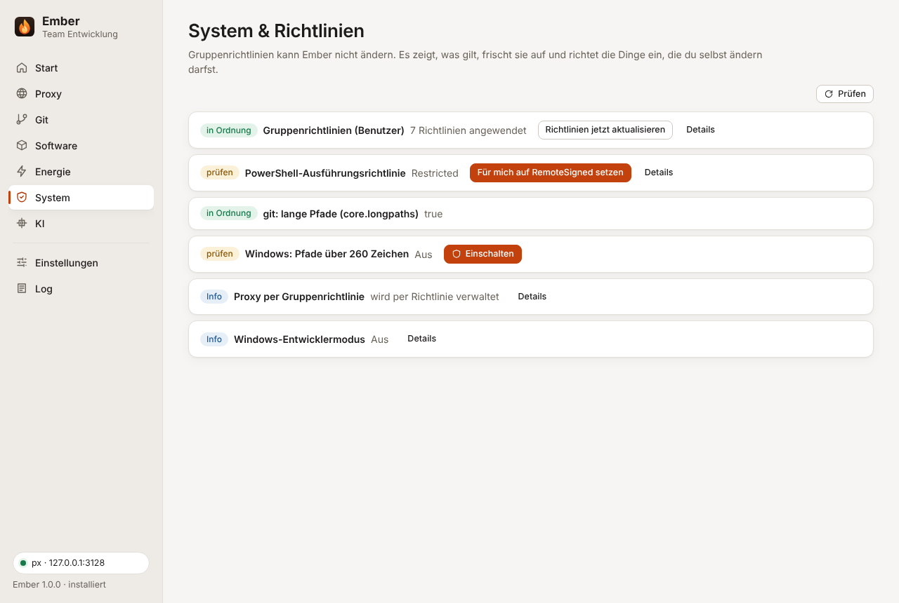

Gruppenrichtlinien ändern kann Ember nicht und soll es auch nicht. Die Seite zeigt, was gilt, frischt Richtlinien auf und richtet die wenigen Dinge ein, die du selbst ändern darfst.

| Prüfung | Was Ember zeigt | Was Ember tun kann |
|---|---|---|
| Gruppenrichtlinien (Benutzer) | angewendete GPOs aus `gpresult /scope user /x` | `gpupdate /force` |
| PowerShell-Ausführungsrichtlinie | alle Ebenen aus `Get-ExecutionPolicy -List` | für dich auf `RemoteSigned` setzen, außer eine GPO legt es fest |
| git: lange Pfade | `core.longpaths` | einschalten |
| Windows: Pfade über 260 Zeichen | `LongPathsEnabled` | einschalten (Adminrechte) |
| Proxy per Gruppenrichtlinie | Einträge unter `Policies\…\Internet Settings` | nur Anzeige |
| Windows-Entwicklermodus | an oder aus | nur Anzeige |

`gpresult` liefert XML, dadurch hängt die Auswertung nicht an der Windows-Sprache. Gezählt werden nur Richtlinien, die wirklich greifen. Was durch einen Filter ausgeschlossen ist, fehlt in der Liste.

Ein Klick auf „Details“ zeigt die Rohdaten, etwa die vollständige GPO-Liste oder die Ausgabe von `gpupdate`.
